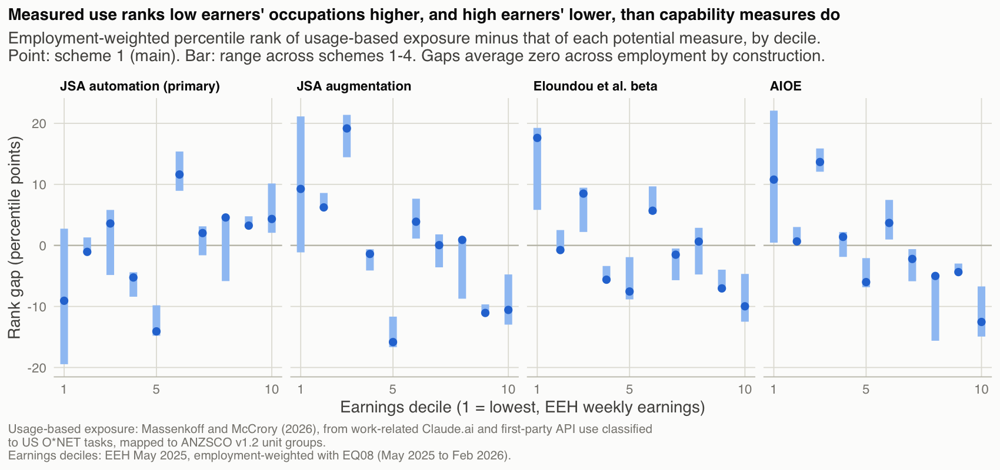
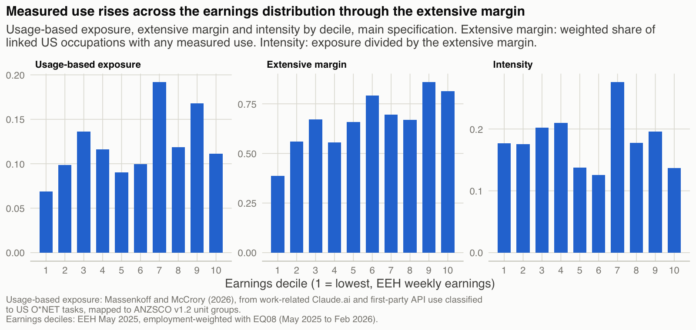

```{r setup}
source("../note/_setup.R")
```

**Purpose.** This memo sets out the method of a short descriptive project, with the first two charts, so that reviewers can comment on the method before the working draft is released. The questions at the end are where comments would help most.

**What is measured.** The usage-based exposure scores come from task-level Claude.ai and first-party API use by self-selected users of one provider, classified to US O\*NET tasks [@massenkoff2026]. No Australian occupational AI use is measured. The scores are applied to Australian occupation mixes, and the project describes how they are spread across Australia's earnings distribution and how they differ from measures of AI potential. It is not a job-loss or career-risk score, and it estimates no effects. DEWR has already converted the same scores to ANZSCO and used them in a model of employment [@dewr2026]. This project adds earnings, the usage-potential comparison, Western Australia and the split by sex.

## Data

| Role | Source |
|---|---|
| Usage-based exposure | Massenkoff and McCrory observed exposure, SOC `2018` (`r num("je_rows")` occupations, `r pc("je_zero_share", 0)` exactly zero) |
| Potential exposure | JSA automation and augmentation [@jsa2025]; Eloundou et al. beta [@eloundou2024]; AIOE, aggregate only [@felten2021] |
| Employment | ABS `EQ08`, ANZSCO `v1.2` unit groups, average of May `2025` to February `2026` (`r num("emp_total_m", 2)` million employed) |
| Earnings | EEH May `2025`, weekly total cash earnings, all employees; alternatives: EEH hourly (three-digit) and ATO salary or wages |
| Crosswalks | BLS SOC `2018`-`2010`, BLS `ISCO-08`-SOC `2010`, ABS ANZSCO-`ISCO-08`; JSA's direct ANZSCO-O\*NET correspondence |
| US weights | BLS OEWS May `2025` employment |

## Method

**From US occupations to Australian units.** A unit's usage-based exposure is the weighted mean of the scores of its linked US occupations, with weights renormalised over occupations that have a score. The extensive margin applies the same weights to an indicator of any measured use; intensity is exposure divided by the extensive margin. Four weighting schemes are run throughout: OEWS employment weights (primary), equal weights, title-match-first, and JSA's direct correspondence. Coverage is `r pc("coverage")` of employment. Each unit is graded by the number of US occupations feeding it; units fed by five or more hold `r pc("grade_emp_diffuse")` of employment, and every result is repeated without them.

**Earnings deciles.** Units are ranked by EEH weekly earnings and split into employment-weighted deciles, with units that straddle a boundary divided between deciles. Each decile holds exactly a tenth of employment. The project reports decile means, the top-minus-bottom difference in exposure points (exposure × `100`) and the concentration index $2\,\mathrm{cov}(e,r)/\bar{e}$. Because that index depends on each measure's mean, measures are compared with a rank index $4\,\mathrm{cov}(R_e,r)$, added after the first results.

**Usage against potential.** For each unit, the gap is the employment-weighted percentile rank of usage-based exposure minus that of a potential measure, with tied values at the mid-rank, averaged by decile. JSA automation is the primary comparator. The comparison with Eloundou beta is partly mechanical, because the usage-based score is gated on that beta. Because ranks average out over employment, gaps average zero, and all zero-exposure units share one rank.

**What counts as holding.** Fixed before results: a decile profile holds if its slope has the same sign as the primary and the Spearman correlation of decile means is at least `0.7`; the gap holds if its sign at both ends is the same under all four schemes. Of `r num("specs")` specifications, `r num("specs_hold")` hold; the concentration index is positive in all of them.

## First charts

{width="100%"}

{width="100%"}

## Questions for reviewers

1. **Earnings ranking.** No hourly earnings are published at unit-group level, so the primary ranking uses weekly earnings of all employees, which mixes pay rates with hours. Is that defensible, or should the hourly three-digit series lead?
2. **Crosswalk.** The primary chain runs through `ISCO-08`; JSA's direct correspondence gives a noticeably different profile, largely because of one large unit. Which chain would you trust as primary, and is restricting to non-diffuse units a sensible check?
3. **The gap.** Is a difference in employment-weighted percentile ranks the right way to compare a usage measure with potential measures on different scales? Would you prefer z-scores or levels?
4. **Zeros.** Over half of the scored US occupations are exactly zero because of a usage gate. Should the extensive margin, rather than the score, be the headline?
5. **Independent potential measures.** Beyond JSA and AIOE, is there a measure of AI potential for Australian occupations that is independent of Eloundou et al.'s task ratings?
6. **Related work.** Are you aware of work that reports usage-based exposure by Australian earnings, which a search on `25` October `2026` may have missed?

*No funding. The analysis code was written with Claude Code, an AI coding assistant, under the author's direction, and Claude Code drafted this memo; the author reviewed and approved it.*

## References {.unnumbered}

::: {#refs}
:::
