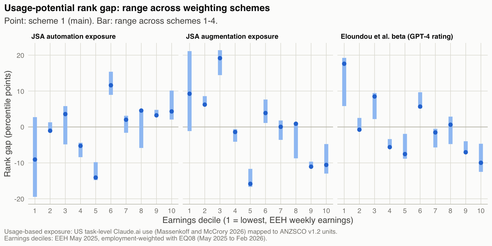
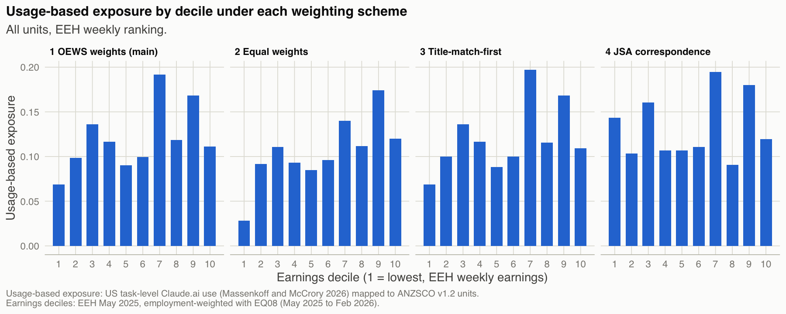
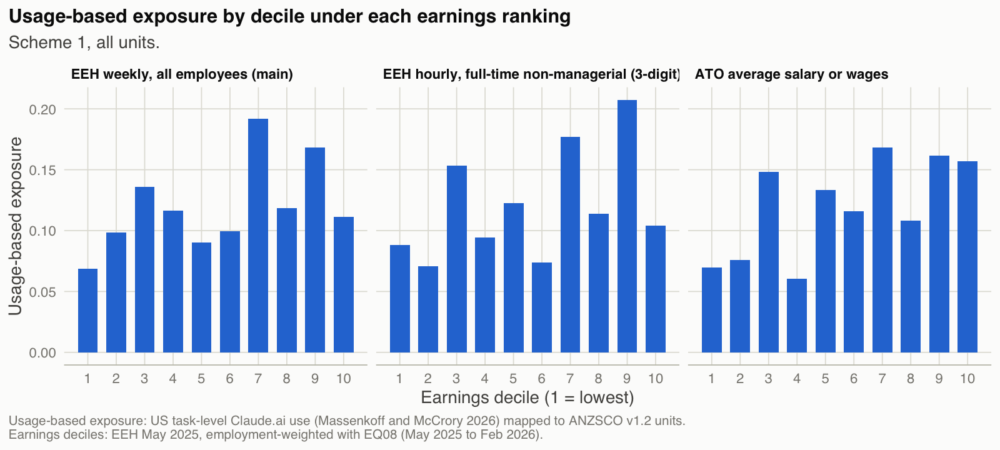
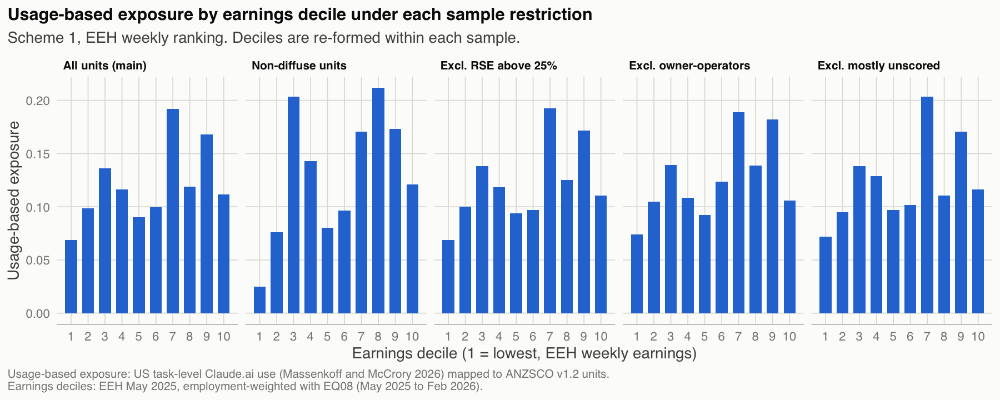
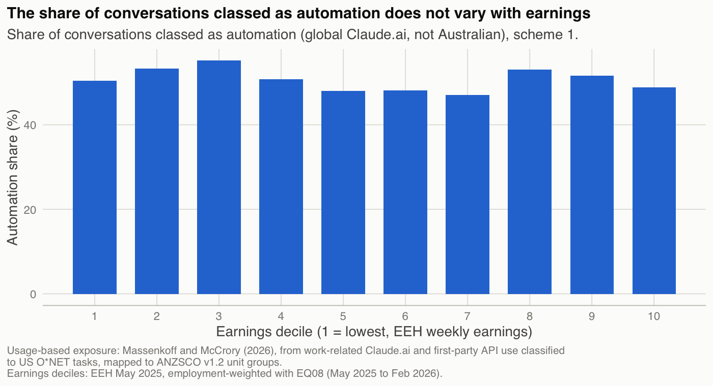

```{r setup}
source("_setup.R")
library(tidyr)
v12 <- read_codes_csv(interim_path("v12_units.csv"))
emp <- read_codes_csv(interim_path("emp_units.csv"))
tab <- function(d, ...) kable(d, ..., format = "pipe")
```

Every table here is read from pipeline output. File paths refer to the project repository.

## Alternative specifications

The main text uses one specification: weighting scheme `1`, all units, EEH weekly earnings. This section reports every alternative, including those that do not hold under the rule in the Methods section. Two items were added after the first results were seen: the exclusion of units whose US counterparts are mostly unscored, and the influence table.









## Sensitivity table

Decile profiles of usage-based exposure under every weighting scheme, sample and earnings ranking. "Holds" applies the rule in the Methods section against the primary specification (scheme `1`, all units, EEH weekly earnings).

```{r sensitivity}
lab_s <- c(s1 = "1 OEWS", s2 = "2 Equal", s3 = "3 Title", s4 = "4 JSA links")
lab_r <- c(eeh = "EEH weekly", eeh13 = "EEH hourly (cube 13)", ato = "ATO salary")
lab_m <- c(all = "All units", non_diffuse = "Non-diffuse", excl_rse25 = "Excl. RSE above 25%", excl_owner_managers = "Excl. owner-operators (draft)", excl_unscored_majority = "Excl. mostly unscored (added after results)")
m3("sensitivity_table.csv") |>
  arrange(scheme, factor(sample, names(lab_m)), factor(ranking, names(lab_r))) |>
  transmute(Scheme = lab_s[scheme], Sample = lab_m[sample], Ranking = lab_r[ranking],
            `Decile 1` = round(usage_d1, 3), `Decile 10` = round(usage_d10, 3),
            `Top minus bottom (pp)` = round(top_minus_bottom_pp, 1),
            `Spearman with primary` = round(spearman_with_primary, 2),
            CI = round(ci_usage, 3), Holds = if_else(holds, "yes", "no")) |>
  tab()
```

## Usage-potential gap: bottom and top quintiles

Mean rank gap (percentile points) in the bottom and top earnings quintiles, all units. AIOE appears only in this aggregate form.

```{r quintiles}
lab_p <- c(jsa_automation = "JSA automation", jsa_augmentation = "JSA augmentation", beta_gpt4 = "Eloundou beta", aioe = "AIOE")
m3("gap_quintiles.csv") |>
  filter(sample == "all") |>
  arrange(factor(potential, names(lab_p)), factor(ranking, names(lab_r)), scheme) |>
  transmute(Potential = lab_p[potential], Ranking = lab_r[ranking], Scheme = lab_s[scheme],
            `Bottom quintile` = round(gap_rank_q1, 1), `Top quintile` = round(gap_rank_q5, 1)) |>
  tab()
```

```{r signcheck}
m3("gap_sign_check.csv") |>
  filter(sample == "all") |>
  transmute(Potential = lab_p[potential], Ranking = lab_r[ranking],
            `Bottom sign same in all schemes` = if_else(bottom_sign_same_all_schemes, "yes", "no"),
            `Top sign same in all schemes` = if_else(top_sign_same_all_schemes, "yes", "no")) |>
  tab()
```

## Influence of single large units

The top-minus-bottom difference with each of the five largest units in deciles one and ten left out in turn. This check was added after the first results.

```{r influence}
m3("influence_largest_units.csv") |>
  transmute(Scheme = lab_s[scheme], `Left out` = if_else(left_out == "none", "(none)", paste(left_out, title)),
            `Top minus bottom (pp)` = round(top_minus_bottom_pp, 1)) |>
  tab()
```

## Rank correlations

Employment-weighted Spearman correlations between usage-based exposure and each potential measure, by weighting scheme.

```{r correlations}
m3("correlations.csv") |>
  transmute(Scheme = lab_s[scheme], Potential = lab_p[potential], Units = units,
            `Weighted` = round(spearman_weighted, 2), `Unweighted` = round(spearman_unweighted, 2)) |>
  tab()
```

## Largest rank disagreements with JSA automation

The fifteen units with the largest gap under scheme `1` whose sign is the same under all four schemes. A negative gap means usage-based exposure ranks the unit lower than JSA automation does.

```{r disagreements}
m3("largest_disagreements_jsa.csv") |>
  transmute(Unit = unit, Title = title, `Employment ('000)` = round(emp, 1),
            `Usage-based exposure` = if_else(usage == 0, "0.00 (below usage threshold)", sprintf("%.2f", usage)),
            `JSA automation` = jsa_automation, `Gap, scheme 1` = round(gap_s1, 1), `Gap, scheme 2` = round(gap_s2, 1),
            `Gap, scheme 3` = round(gap_s3, 1), `Gap, scheme 4` = round(gap_s4, 1)) |>
  tab()
```

## Review of the forty largest units

Automated checks on the forty largest units (decision `D10` in the decision log, carried out by Claude Code). The full table, with a resolution and reason for each flag, is `data/out/m2/top40_units_review.csv`.

```{r top40}
read_csv(out_path("m2", "top40_check_summary.csv"), show_col_types = FALSE) |>
  mutate(check = sub("^flag_", "", check)) |>
  transmute(Check = check, `Units flagged` = units_flagged) |>
  tab()
read_codes_csv(out_path("m2", "top40_units_review.csv")) |>
  filter(flags != "") |>
  transmute(Unit = unit, Title = title,
            `Usage, scheme 1` = if_else(is.na(usage_s1), "no score", sprintf("%.3f", usage_s1)),
            Flags = flags, Note = coalesce(unit_note, "")) |>
  tab()
```

## Global automation share by decile



## Rebuilding the usage-based score from task data

The published occupation scores were rebuilt from the published task-level values, using O*NET task weights in place of the unpublished time shares Massenkoff and McCrory use. The rank correlation with the published scores falls short of the `0.9` target. The main analysis uses the published scores.

```{r replication}
read_csv(out_path("g_replication.csv"), show_col_types = FALSE) |>
  transmute(`Task weights` = weights, `SOC codes compared` = socs_compared,
            Spearman = round(spearman, 3), `Agreement on exact zeros` = scales::percent(zero_agreement, 1),
            `Meets target` = if_else(meets_target, "yes", "no")) |>
  tab()
```

## Data sources and licences

```{r sources}
man <- read_csv(raw_path("MANIFEST.csv"), col_types = cols(.default = "c"))
man |>
  transmute(Source = id, Version = version_or_commit, Licence = licence, Accessed = access_date) |>
  tab()
```

## Edition bridge: ANZSCO `2022` to `v1.2`

Unit-group pairs that do not keep the same code. The full table is `data/interim/bridge_2022units_v12units.csv`.

```{r bridge}
read_codes_csv(interim_path("bridge_2022units_v12units.csv")) |>
  filter(type != "same code") |>
  left_join(v12 |> rename(unit_v12 = unit, v12_title = title), by = "unit_v12") |>
  transmute(`2022 unit` = unit2022, `v1.2 unit` = unit_v12, `v1.2 title` = v12_title,
            `Six-digit links` = n_links6, Type = type) |>
  tab()
```

## Earnings imputations

Units without a published EEH value after bridging, and the parent level used.

```{r imputations}
read_codes_csv(out_path("m2", "earnings_imputation_log.csv")) |>
  transmute(Unit = unit, Title = title, `EEH weekly` = eeh_imputed, `EEH cube 13 hourly` = eeh13_imputed, ATO = ato_imputed) |>
  tab()
```

## Units without usage-based exposure

```{r unmatched}
read_codes_csv(out_path("unmatched_units.csv")) |>
  transmute(Unit = unit, Title = title, `Employment ('000)` = round(emp_000, 1), `Share of employment` = scales::percent(emp_share, 0.01)) |>
  tab()
```

## Primary chain against the `2022`-path chain

Units whose linked US occupations differ between the two chains.

```{r validation}
read_codes_csv(out_path("m2", "chain_validation_primary_vs_2022path.csv")) |>
  filter(is.na(jaccard) | jaccard < 1) |>
  left_join(v12, by = "unit") |>
  transmute(Unit = unit, Title = title, `Primary links` = n_primary, `2022-path links` = n_alt,
            `Jaccard` = round(jaccard, 2), `Only in primary` = coalesce(only_primary, ""),
            `Only in 2022 path` = coalesce(only_alt, "")) |>
  tab()
```

## US employment weights not taken directly from OEWS

```{r oews}
read_codes_csv(interim_path("soc_weights_oews.csv")) |>
  filter(source != "OEWS detailed") |>
  left_join(read_codes_csv(interim_path("soc_measures.csv")) |> select(soc, title), by = "soc") |>
  transmute(SOC = soc, Title = title, Weight = format(round(w), big.mark = ","), Source = source) |>
  tab()
```

US military occupations (SOC major group `55`) have no OEWS employment and no usage-based exposure, so they carry no weight.

## AEI occupation-group shares: published mass and suppressed cells

```{r mass}
m3("aei_major_group_missing_mass.csv") |>
  transmute(Geography = geo_id, Month = period, `Published share (%)` = round(published_pct, 2),
            `Groups published` = groups_published) |>
  tab()
m3("aei_major_group_suppressed_cells.csv") |>
  transmute(Geography = geo_id, Month = period, `SOC major group` = soc_major, Name = node_name) |>
  tab()
```

## Draft list of owner-operator units

Excluded in one sensitivity run. This is a judgement list awaiting review (see the Methods section).

```{r owners}
source("../R/fn_owner_managers.R")
v12 |> filter(unit %in% owner_manager_draft) |> transmute(Unit = unit, Title = title) |> tab()
```

