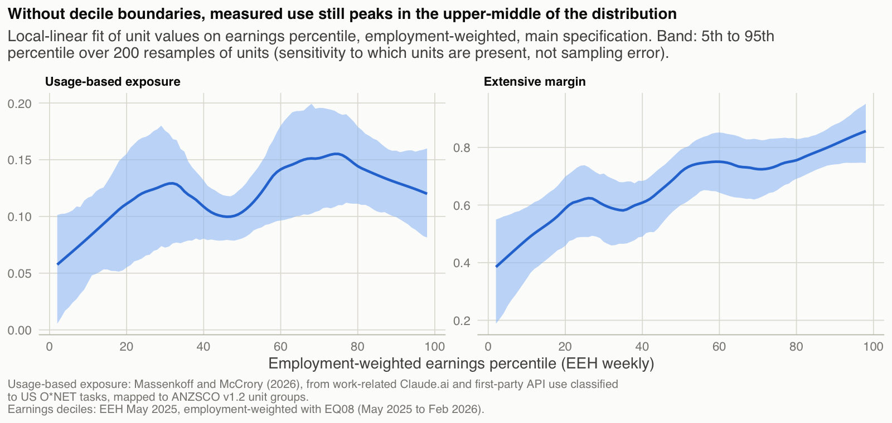

```{r setup}
source("_setup.R")
library(tidyr)
v12 <- read_codes_csv(interim_path("v12_units.csv"))
emp <- read_codes_csv(interim_path("emp_units.csv"))
tab <- function(d, ...) kable(d, ..., format = "pipe")
```

Every table here is read from pipeline output. File paths refer to the project repository. Differences in exposure are in exposure points (exposure × `100`); rank gaps are in percentile points. Items added after the first results, including those added after review of the first draft, are labelled.

## Alternative specifications

The main text uses one specification: weighting scheme `1`, all units, EEH weekly earnings. This section reports every alternative, including those that do not hold under the rule in the Methods section.


## Sensitivity table

Decile profiles of usage-based exposure under every weighting scheme, sample and earnings ranking. "Holds" applies the rule in the Methods section against the primary specification (scheme `1`, all units, EEH weekly earnings): the OLS slope of the decile means (shown, in exposure points per decile) has the main profile's sign, and the Spearman correlation with the main profile is at least `0.7`. The concentration index (CI) and the rank index (rank CI, added after the first results) summarise the whole distribution.

```{r sensitivity}
lab_s <- c(s1 = "1 OEWS", s2 = "2 Equal", s3 = "3 Title", s4 = "4 JSA links")
lab_r <- c(eeh = "EEH weekly", eeh13 = "EEH hourly (cube 13)", ato = "ATO salary")
lab_m <- c(all = "All units", non_diffuse = "Non-diffuse", excl_rse25 = "Excl. RSE above 25%", excl_owner_managers = "Excl. owner-operators (draft)", excl_unscored_majority = "Excl. mostly unscored (added after results)")
m3("sensitivity_table.csv") |>
  arrange(scheme, factor(sample, names(lab_m)), factor(ranking, names(lab_r))) |>
  transmute(Scheme = lab_s[scheme], Sample = lab_m[sample], Ranking = lab_r[ranking],
            `Decile 1` = round(usage_d1, 3), `Decile 10` = round(usage_d10, 3),
            `Top minus bottom` = round(top_minus_bottom_pp, 1), Slope = round(slope_pp, 2),
            `Spearman with primary` = round(spearman_with_primary, 2),
            CI = round(ci_usage, 3), `Rank CI` = round(rank_ci_usage, 3), Holds = if_else(holds, "yes", "no")) |>
  tab()
```

## The profile without decile boundaries

Added after review of the first draft. Decile means can exaggerate single-unit spikes, so the profile is also shown as a smoothed curve over earnings percentiles.



## Margins, lower bound and capability analogue by decile

Main specification. The log decomposition compares each decile with decile `1`: $\ln(e_d/e_1)=\ln(m_d/m_1)+\ln(i_d/i_1)$. The lower bound counts linked US occupations without a score as zero instead of renormalising over scored ones. The capability analogue applies the same weights to an indicator of a positive Eloundou et al. beta. All three were added after review of the first draft.

```{r margins}
dp <- m3("decile_profiles.csv") |> filter(scheme == "s1", sample == "all", ranking == "eeh") |> arrange(decile)
mg <- m3("margin_decomposition.csv") |> select(decile, extensive_share)
dp |> left_join(mg, by = "decile") |>
  transmute(Decile = decile, Exposure = round(usage, 3), `Lower bound` = round(usage_lb, 3),
            `Extensive margin` = round(extensive, 3), Intensity = round(intensity, 3),
            `Share of linked occupations with beta > 0` = round(beta_ext, 3),
            `Extensive share of log difference from decile 1` = if_else(is.na(extensive_share), "", scales::percent(extensive_share, 1))) |>
  tab()
```

## Concentration indices for every measure

Main specification. The level index $2\,\mathrm{cov}(e,r)/\bar e$ depends on each measure's mean and is not comparable across measures. The rank index $4\,\mathrm{cov}(R_e,r)$ is; without ties it equals one third of the weighted Spearman correlation with earnings. The Erreygers index applies to measures bounded on $[0,1]$. The generalised index $2\,\mathrm{cov}(e,r)$ is in the measure's own units. AIOE takes negative values, so its level and Erreygers indices are not defined. Rank, Erreygers and generalised indices were added after review of the first draft.

```{r concentration}
lab_c <- c(usage = "Usage-based exposure", usage_lb = "Usage-based exposure, lower bound", extensive = "Extensive margin",
           beta_ext = "Share of linked occupations with beta > 0", jsa_automation = "JSA automation", jsa_augmentation = "JSA augmentation",
           beta_gpt4 = "Eloundou beta", aioe = "AIOE")
m3("concentration_indices.csv") |>
  mutate(measure = factor(lab_c[measure], levels = lab_c)) |> arrange(measure) |>
  transmute(Measure = measure, Level = if_else(is.na(ci), "", sprintf("%.3f", ci)), Rank = sprintf("%.3f", rank_ci),
            Erreygers = if_else(is.na(erreygers), "", sprintf("%.3f", erreygers)), Generalised = sprintf("%.4f", generalised),
            `Employment covered` = scales::percent(emp_covered, 0.1)) |>
  tab()
```

## Usage-potential gap: bottom and top quintiles

Mean rank gap (percentile points) in the bottom and top earnings quintiles, all units. AIOE appears only in this aggregate form.

```{r quintiles}
lab_p <- c(jsa_automation = "JSA automation", jsa_augmentation = "JSA augmentation", beta_gpt4 = "Eloundou beta", aioe = "AIOE")
m3("gap_quintiles.csv") |>
  filter(sample == "all") |>
  arrange(factor(potential, names(lab_p)), factor(ranking, names(lab_r)), scheme) |>
  transmute(Potential = lab_p[potential], Ranking = lab_r[ranking], Scheme = lab_s[scheme],
            `Bottom quintile` = round(gap_rank_q1, 1), `Top quintile` = round(gap_rank_q5, 1)) |>
  tab()
```

```{r signcheck}
m3("gap_sign_check.csv") |>
  filter(sample == "all") |>
  transmute(Potential = lab_p[potential], Ranking = lab_r[ranking],
            `Bottom sign same in all schemes` = if_else(bottom_sign_same_all_schemes, "yes", "no"),
            `Top sign same in all schemes` = if_else(top_sign_same_all_schemes, "yes", "no")) |>
  tab()
```

**Without zero-exposure units.** Added after review of the first draft. All units with zero usage-based exposure share one tied rank, so their gaps are set by the potential measure alone. Here the gaps are recomputed among units with positive exposure, within the same deciles (EEH weekly ranking). Averaging over random tie-breaks would give exactly the mid-rank results above, because the expected rank under random tie-breaking is the mid-rank.

```{r quintiles_nonzero}
m3("gap_quintiles_nonzero.csv") |>
  arrange(factor(potential, names(lab_p)), scheme) |>
  transmute(Potential = lab_p[potential], Scheme = lab_s[scheme],
            `Bottom quintile` = round(gap_rank_q1, 1), `Top quintile` = round(gap_rank_q5, 1)) |>
  tab()
```

## Influence of single large units

The top-minus-bottom difference, decile `7` (the peak), and the concentration indices with each of the five largest units in deciles `1`, `7` and `10` left out in turn. Deciles are re-formed each time. "Holds" applies the rule against the main profile. This check was added after the first results and extended to decile `7`, the indices and the rule after review of the first draft.

```{r influence}
m3("influence_largest_units.csv") |>
  transmute(Scheme = lab_s[scheme], `Left out` = if_else(left_out == "none", "(none)", paste(left_out, title)),
            `From decile` = if_else(is.na(from_decile), "", as.character(from_decile)),
            `Top minus bottom` = round(top_minus_bottom_pp, 1), `Decile 7` = round(d7, 3),
            CI = round(ci_usage, 3), `Rank CI` = round(rank_ci_usage, 3), Holds = if_else(holds, "yes", "no")) |>
  tab()
```

## Rank correlations

Employment-weighted Spearman correlations between usage-based exposure and each potential measure, by weighting scheme. Under scheme `4`, `r num("s4_units")` units have links and `r num("s4_units_scored")` have a scored link.

```{r correlations}
m3("correlations.csv") |>
  transmute(Scheme = lab_s[scheme], Potential = lab_p[potential], Units = units,
            `Weighted` = round(spearman_weighted, 2), `Unweighted` = round(spearman_unweighted, 2)) |>
  tab()
```

## Largest rank disagreements with JSA automation

The fifteen units with the largest gap under scheme `1` whose sign is the same under all four schemes. The scheme columns give the gap, in percentile points, under each weighting scheme. A negative gap means usage-based exposure ranks the unit lower than JSA automation does. "Contribution" is the scheme-`1` gap times the unit's share of employment, in percentile points (added after the first results).

```{r disagreements}
dis_tab <- function(d) d |>
  transmute(Unit = unit, Title = title, `Employment ('000)` = round(emp, 1),
            `Usage-based exposure` = if_else(usage == 0, "0.000†", sprintf("%.3f", usage)),
            `JSA automation` = jsa_automation, `Scheme 1` = round(gap_s1, 1), `Scheme 2` = round(gap_s2, 1),
            `Scheme 3` = round(gap_s3, 1), `Scheme 4` = round(gap_s4, 1), Contribution = round(contribution_s1, 2)) |>
  tab()
dis_tab(m3("largest_disagreements_jsa.csv"))
```

† Below the usage threshold: a score of exactly zero.

**Ranked by contribution.** The fifteen sign-stable disagreements with the largest employment-weighted contribution. Added after review of the first draft, because ranking by the gap alone puts small units first.

```{r disagreements_weighted}
dis_tab(m3("largest_disagreements_jsa_weighted.csv"))
```

## Women and men: within and between deciles

Added after review of the first draft. The difference between women's and men's mean usage-based exposure is split into a within-decile part, which weights the decile differences by the average of women's and men's employment shares, and a between-decile part, which weights the difference in shares by the average of the two means. The parts add to the total.

```{r sex_decomposition}
m3("sex_decomposition.csv") |>
  transmute(`Women minus men` = round(total, 4), `Within deciles` = round(within, 4), `Between deciles` = round(between, 4),
            `Within share` = scales::percent(within_share, 1)) |>
  tab()
```

## Western Australia: contributions by major group

WA minus national mean usage-based exposure (× `100`), by major group. "Raw" is $\sum_{a\in g}(s^{WA}_a - s^{AUS}_a)e_a$, as in the first draft; "relative to the national mean" subtracts the national mean from $e_a$ and does not depend on the level of the measure. Both sum to the same total. The normalised version was added after review of the first draft.

```{r wa_contrib}
major_names <- c(`1` = "Managers", `2` = "Professionals", `3` = "Technicians and Trades Workers",
                 `4` = "Community and Personal Service Workers", `5` = "Clerical and Administrative Workers",
                 `6` = "Sales Workers", `7` = "Machinery Operators and Drivers", `8` = "Labourers")
m3("wa_decomposition.csv") |> filter(level == "major", measure == "usage") |>
  transmute(`Major group` = major_names[group], `WA share` = scales::percent(share_wa, 0.1), `National share` = scales::percent(share_aus, 0.1),
            Raw = round(100 * contribution, 2), `Relative to the national mean` = round(100 * contribution_norm, 2)) |>
  tab()
m3("wa_vs_national.csv") |>
  transmute(Measure = c(usage = "Usage-based exposure", extensive = "Extensive margin", jsa_automation = "JSA automation", beta_gpt4 = "Eloundou beta")[measure],
            WA = round(mean_wa, 3), Australia = round(mean_aus, 3), Difference = round(wa_gap, 4),
            `Relative difference` = scales::percent(wa_gap_relative, 0.1)) |>
  tab()
```

## Usage relative to employment: published and rescaled shares

The published SOC major-group shares do not sum to one hundred per cent (see the last tables of this appendix). "Rescaled" divides each geography and month by its published total before taking the ratio to employment. Added after review of the first draft.

```{r usage_index}
m3("soc_major_usage_index.csv") |> filter(!is.na(usage_index)) |>
  arrange(geo_id, desc(usage_index)) |>
  transmute(Geography = geo_id, `SOC major group` = node_name, Published = round(usage_index, 2), Rescaled = round(usage_index_rescaled, 2)) |>
  tab()
```

## Another platform: Copilot-based applicability

Added for `v1.0`, after the first results. Microsoft's AI applicability score (Tomlinson et al. 2025, CC BY `4.0`) is mapped to ANZSCO through the same links and weights as the usage-based score. Measures are compared on employment-weighted ranks. The composite is the mean of each unit's two percentile ranks; with two sources the median equals the mean.

```{r platform_main}
lab_o <- c(usage = "Claude usage-based exposure", copilot = "Copilot AI applicability", jsa_automation = "JSA automation",
           jsa_augmentation = "JSA augmentation", beta_gpt4 = "Eloundou beta", aioe = "AIOE")
m3("other_platform_main.csv") |>
  mutate(measure = factor(lab_o[measure], levels = lab_o)) |> arrange(measure) |>
  transmute(Measure = measure, Units = units, `Rank index` = sprintf("%.3f", rank_ci),
            `Rank correlation with Claude usage` = sprintf("%.2f", spearman_with_usage),
            `Rank correlation with earnings` = sprintf("%.2f", spearman_with_earnings)) |>
  tab()
```

Every specification: rank indices on the units with both measures.

```{r platform_specs}
m3("other_platform_sensitivity.csv") |>
  arrange(scheme, factor(sample, names(lab_m)), factor(ranking, names(lab_r))) |>
  transmute(Scheme = lab_s[scheme], Sample = lab_m[sample], Ranking = lab_r[ranking], Units = units,
            `Claude` = round(rank_ci_usage, 3), `Copilot` = round(rank_ci_copilot, 3), Composite = round(rank_ci_composite, 3),
            `Rank correlation` = round(spearman_usage_copilot, 2)) |>
  tab()
```

## Uncertainty: design and ranges

Added for `v1.0`, after the first results.

- **Crosswalk weights.** Each unit's scheme-`1` weights $p$ over its $n$ scored US occupations are redrawn from $\mathrm{Dirichlet}(\alpha n p)$. The concentration $\alpha$ is chosen from a grid so that the employment-weighted average spread of unit values across draws is closest to their spread across schemes `1` to `3`. The wider setting uses $\alpha/4$.
- **Earnings.** Each unit's EEH weekly earnings are multiplied by $1+\varepsilon$, with $\varepsilon$ normal with standard deviation equal to the unit's published relative standard error (the median where none is published), independently across units. Ranks and deciles are re-formed in every draw.
- **Employment** is held fixed. `EQ08` publishes no standard errors.
- **Draws.** `r num("unc_draws")` per setting, with a fixed seed, so reruns give identical results.

```{r alpha}
m3("uncertainty_alpha_calibration.csv") |>
  transmute(alpha, `Spread across draws` = round(mean_sd, 4), `Spread across schemes 1-3` = round(target_sd, 4),
            Chosen = if_else(chosen, "yes", "")) |>
  tab()
```

Ranges over draws (`5`th, `50`th and `95`th percentiles).

```{r ranges}
lab_u <- c(crosswalk = "Crosswalk", crosswalk_wide = "Crosswalk, wider", earnings = "Earnings", both = "Both")
m3("uncertainty_ranges.csv") |> mutate(type = factor(lab_u[type], levels = lab_u)) |> arrange(type) |>
  transmute(Draws = type,
            `Top minus bottom` = sprintf("%.1f / %.1f / %.1f", tmb_p05, tmb_p50, tmb_p95),
            CI = sprintf("%.3f / %.3f / %.3f", ci_p05, ci_p50, ci_p95),
            `Rank CI` = sprintf("%.3f / %.3f / %.3f", rank_ci_p05, rank_ci_p50, rank_ci_p95)) |>
  tab()
```

**Bounds for unscored links.** Lower: unscored US occupations count as zero. Upper: they count as one, the highest possible score. The high imputation gives them the highest score in their SOC minor group (major group if the minor group has none); it is not a bound, because for some units that score is below the mean of their scored links.

```{r bounds}
lab_b <- c(lower = "Lower bound (zero)", main = "Main (renormalised)", high_imputation = "High imputation", upper = "Upper bound (one)")
m3("bounds_unscored.csv") |> distinct(bound, tmb, ci, rank_ci, peak_decile, holds) |>
  mutate(bound = factor(lab_b[bound], levels = lab_b)) |> arrange(bound) |>
  transmute(Version = bound, `Top minus bottom` = round(tmb, 1), CI = round(ci, 3), `Rank CI` = round(rank_ci, 3),
            `Peak decile` = peak_decile, `Holds under the rule` = if_else(holds, "yes", "no")) |>
  tab()
```

**Largest disagreements.** Share of draws in which each of the fifteen largest sign-stable disagreements with JSA automation stays among the fifteen largest.

```{r top15}
m3("uncertainty_top15.csv") |> pivot_wider(names_from = type, values_from = share_in_top15) |>
  left_join(v12, by = "unit") |>
  transmute(Unit = unit, Title = title, Crosswalk = scales::percent(crosswalk, 1), Both = scales::percent(both, 1)) |>
  tab()
```

## Earnings, capability and computer work: full results

Added for `v1.0`, after the first results. Employment-weighted least squares on employment-weighted percentile ranks (`0` to `100`), HC`1` standard errors, `r num("cg_units")` units with every measure. Teleworkability is the classification by Dingel and Neiman (2020) of O\*NET-SOC occupations, averaged to SOC `2010` codes and mapped to units through the SOC `2010` links and US employment weights used for AIOE. Its licence is a software licence (`GPL-3.0`), so no unit-level values are published.

```{r conditional_full}
lab_t <- c(y = "Earnings", tw = "Teleworkability", jsa_automation = "JSA automation", jsa_augmentation = "JSA augmentation",
           beta_gpt4 = "Eloundou beta", aioe = "AIOE")
ctrl <- function(m) {
  if (m == "earnings") return("None")
  parts <- strsplit(sub("^with_", "", m), "_telework")[[1]]
  lab <- if (parts[1] == "" || parts[1] == "telework") character() else lab_t[[parts[1]]]
  out <- paste(c(lab, if (grepl("telework", m)) "teleworkability"), collapse = ", ")
  paste0(toupper(substr(out, 1, 1)), substring(out, 2))
}
m3("conditional_gradient.csv") |> filter(term != "(intercept)") |>
  mutate(Controls = vapply(model, ctrl, character(1))) |>
  transmute(Outcome = if_else(outcome == "usage", "Usage-based exposure", "Extensive margin"), Controls,
            Term = lab_t[term], Estimate = round(estimate, 3), SE = round(se, 3)) |>
  tab()
```

**Gelbach decomposition.** The change in the earnings slope when a potential measure and teleworkability are added, split between them (Gelbach 2016). The two parts add to the change.

```{r gelbach}
m3("conditional_gelbach.csv") |>
  transmute(Outcome = if_else(outcome == "u", "Usage-based exposure", "Extensive margin"), `Potential measure` = lab_t[potential],
            `Slope without controls` = round(base, 3), `Slope with controls` = round(full, 3),
            `Through the potential measure` = round(via_potential, 3), `Through teleworkability` = round(via_telework, 3)) |>
  tab()
```

**Two measures of capability.** JSA augmentation and AIOE treated as two error-prone measures of one capability; the two regressions are stacked and each measure is instrumented with the other (Gillen, Snowberg and Yariv 2019). Both regressions hold teleworkability fixed.

```{r oriv}
m3("conditional_oriv.csv") |>
  transmute(Outcome = if_else(outcome == "u", "Usage-based exposure", "Extensive margin"),
            Earnings = round(earnings, 3), Capability = round(capability, 3), Teleworkability = round(telework, 3)) |>
  tab()
```

## Review of the forty largest units

Automated checks on the forty largest units (decision `D10` in the decision log, carried out by Claude Code and reviewed by the author). The full table, with a resolution and reason for each flag, is `data/out/m2/top40_units_review.csv`.

```{r top40}
read_csv(out_path("m2", "top40_check_summary.csv"), show_col_types = FALSE) |>
  mutate(check = sub("^flag_", "", check)) |>
  transmute(Check = check, `Units flagged` = units_flagged) |>
  tab()
read_codes_csv(out_path("m2", "top40_units_review.csv")) |>
  filter(flags != "") |>
  transmute(Unit = unit, Title = title,
            `Usage, scheme 1` = if_else(is.na(usage_s1), "no score", sprintf("%.3f", usage_s1)),
            Flags = flags, Note = coalesce(unit_note, "")) |>
  tab()
```

## Global automation share by decile


## Rebuilding the usage-based score from task data

The published occupation scores were rebuilt from the published task-level values, using O\*NET task weights in place of the time fractions Massenkoff and McCrory use, which are not published. The rank correlation with the published scores falls short of the `0.9` target. The correlation among occupations with a positive published score (added after the first results) shows how much of the agreement comes from matching zeros. The main analysis uses the published scores.

```{r replication}
read_csv(out_path("g_replication.csv"), show_col_types = FALSE) |>
  transmute(`Task weights` = sub("_x_", " × ", weights), `SOC codes compared` = socs_compared,
            Spearman = round(spearman, 3), `Agreement on exact zeros` = scales::percent(zero_agreement, 1),
            `Positive scores` = socs_nonzero, `Spearman, positive scores` = round(spearman_nonzero, 3),
            `Meets target` = if_else(meets_target, "yes", "no")) |>
  tab()
```

## The two-capital model: premium and benchmark responses

The main text states the responses of the skill premium to ICT, machinery and AI capital. With competitive wages, the skill premium in the thesis's model is
$$\pi=c_\pi\left(\frac{V}{X}\right)^{1/\sigma_{VX}}\left(\frac{X}{S}\right)^{1/\sigma_{XS}}\left(\frac{U}{V}\right)^{1/\sigma_{VU}}\frac{A^S}{A^U},$$
with $s_I=(1-\mu)(K^I)^{\eta_X}/X^{\eta_X}$ ICT's cost share in the skilled branch, $s_S=1-s_I$, and $s_M$ and $s_U=1-s_M$ defined likewise in the unskilled branch. Differentiating $\ln\pi$ with respect to $\ln K^I$ and $\ln K^M$ gives the benchmark responses in the main text; substituting $K^I+\zeta K^A$ for $K^I$ (scenario C) or $A^SN^S+\psi K^A$ for $S$ (scenario D) and applying the chain rule gives the two AI responses. If AI instead performs unskilled tasks, $U\to A^UN^U+\psi K^A$, then
$$\frac{\partial\ln\pi}{\partial\ln K^A}=\frac{\psi K^A}{U}\left[\frac{s_U}{\sigma_{VX}}+\frac{1-s_U}{\sigma_{VU}}\right]>0.$$
Every expression is checked symbolically and numerically in `theory/check_theory.py`, with output in `theory/check_theory_output.txt`. The responses hold technology fixed; how directed technical change would respond to AI is not derived.

## Data sources and licences

Commit hashes are shortened to twelve characters; `data/raw/MANIFEST.csv` gives them in full, with each file's URL and checksum.

```{r sources}
man <- read_csv(raw_path("MANIFEST.csv"), col_types = cols(.default = "c"))
man |>
  transmute(Source = id,
            Version = if_else(grepl("^[0-9a-f]{40}$", version_or_commit), substr(version_or_commit, 1, 12), version_or_commit),
            Licence = licence, Accessed = access_date) |>
  tab()
```

## Edition bridge: ANZSCO `2022` to `v1.2`

Unit-group pairs that do not keep the same code. The full table is `data/interim/bridge_2022units_v12units.csv`.

```{r bridge}
read_codes_csv(interim_path("bridge_2022units_v12units.csv")) |>
  filter(type != "same code") |>
  left_join(v12 |> rename(unit_v12 = unit, v12_title = title), by = "unit_v12") |>
  transmute(`2022 unit` = unit2022, `v1.2 unit` = unit_v12, `v1.2 title` = v12_title,
            `Six-digit links` = n_links6, Type = type) |>
  tab()
```

## Earnings imputations

Units without a published EEH value after bridging, and the parent level used. "none" means the unit has a published value in that source; "not imputed" means it has none and none was imputed (EEH cube `13` covers non-managerial employees only, so the chief executive, general manager and legislator units drop out of the hourly ranking).

```{r imputations}
read_codes_csv(out_path("m2", "earnings_imputation_log.csv")) |>
  transmute(Unit = unit, Title = title, `EEH weekly` = eeh_imputed, `EEH cube 13 hourly` = eeh13_imputed, ATO = ato_imputed) |>
  tab()
```

## Units without usage-based exposure

```{r unmatched}
read_codes_csv(out_path("unmatched_units.csv")) |>
  transmute(Unit = unit, Title = title, `Employment ('000)` = round(emp_000, 1), `Share of employment` = scales::percent(emp_share, 0.01)) |>
  tab()
```

## Primary chain against the `2022`-path chain

Units whose linked US occupations differ between the two chains.

```{r validation}
read_codes_csv(out_path("m2", "chain_validation_primary_vs_2022path.csv")) |>
  filter(is.na(jaccard) | jaccard < 1) |>
  left_join(v12, by = "unit") |>
  transmute(Unit = unit, Title = title, `Primary links` = n_primary, `2022-path links` = n_alt,
            `Jaccard` = round(jaccard, 2), `Only in primary` = gsub(";", "; ", coalesce(only_primary, "")),
            `Only in 2022 path` = gsub(";", "; ", coalesce(only_alt, ""))) |>
  tab()
```

## US employment weights not taken directly from OEWS

```{r oews}
read_codes_csv(interim_path("soc_weights_oews.csv")) |>
  filter(source != "OEWS detailed") |>
  left_join(read_codes_csv(interim_path("soc_measures.csv")) |> select(soc, title), by = "soc") |>
  transmute(SOC = soc, Title = title, Weight = format(round(w), big.mark = ","), Source = source) |>
  tab()
```

US military occupations (SOC major group `55`) have no OEWS employment and no usage-based exposure, so they carry no weight.

## AEI occupation-group shares: published mass and suppressed cells

```{r mass}
m3("aei_major_group_missing_mass.csv") |>
  transmute(Geography = geo_id, Month = period, `Published share (%)` = round(published_pct, 2),
            `Groups published` = groups_published) |>
  tab()
m3("aei_major_group_suppressed_cells.csv") |>
  transmute(Geography = geo_id, Month = period, `SOC major group` = soc_major, Name = node_name) |>
  tab()
```

## Draft list of owner-operator units

Excluded in one sensitivity run. This is a judgement list awaiting review (see the Methods section).

```{r owners}
source("../R/fn_owner_managers.R")
v12 |> filter(unit %in% owner_manager_draft) |> transmute(Unit = unit, Title = title) |> tab()
```

