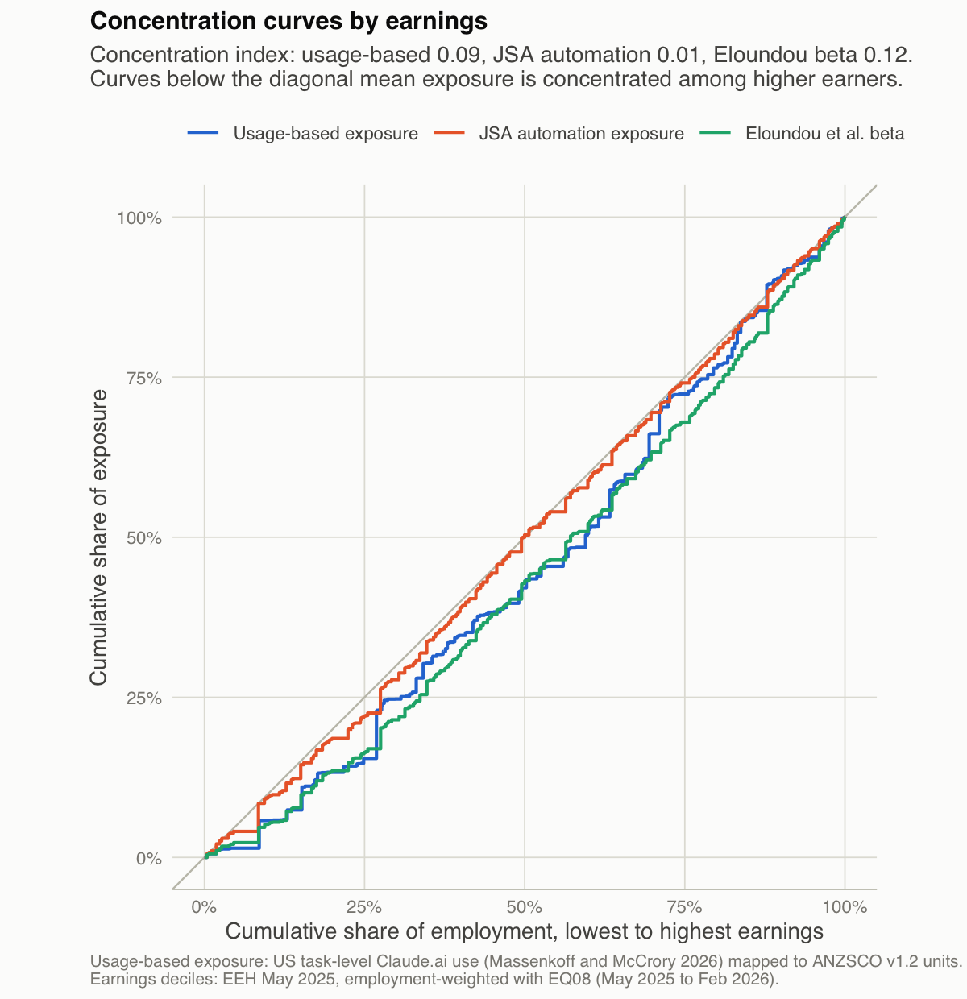
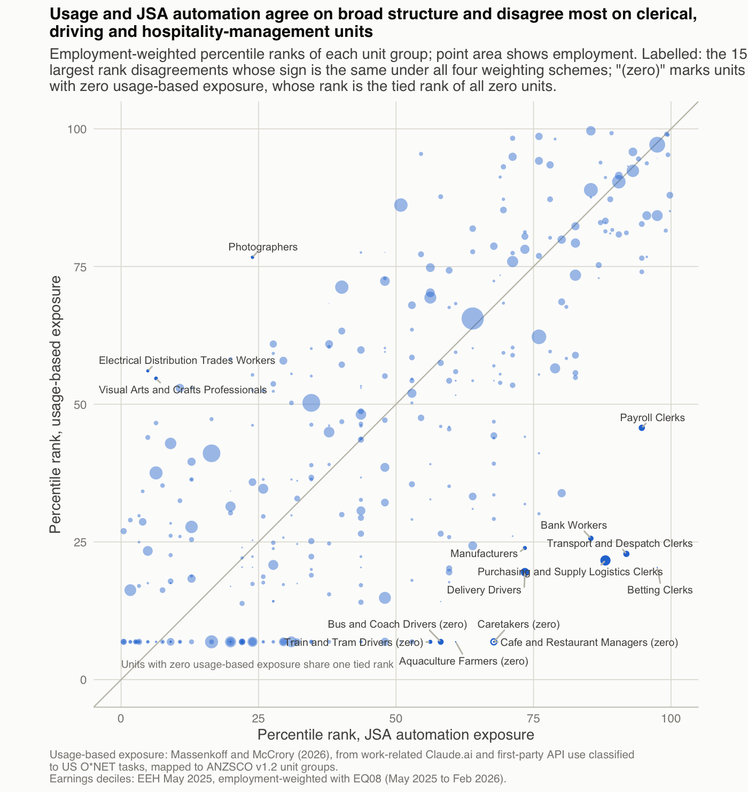
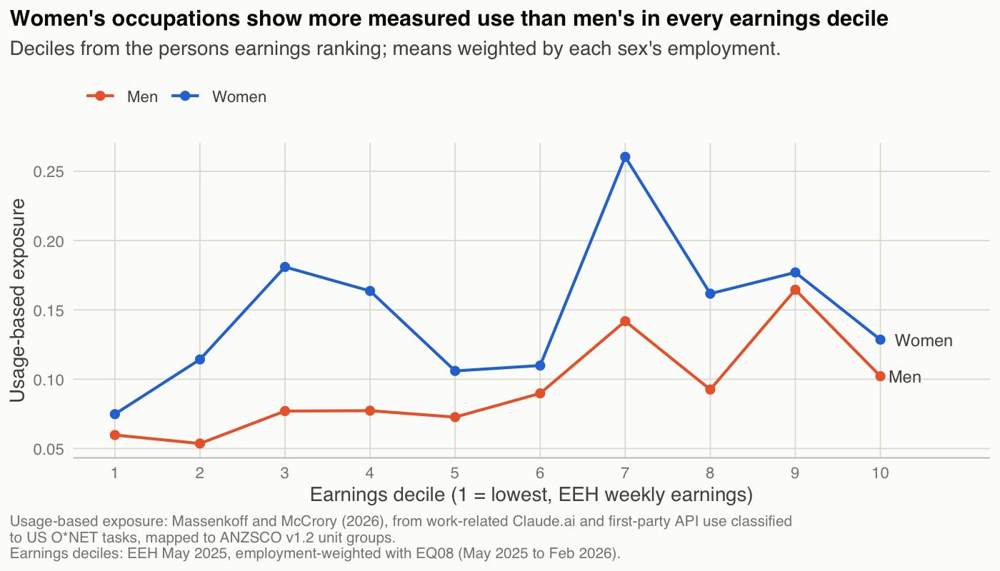
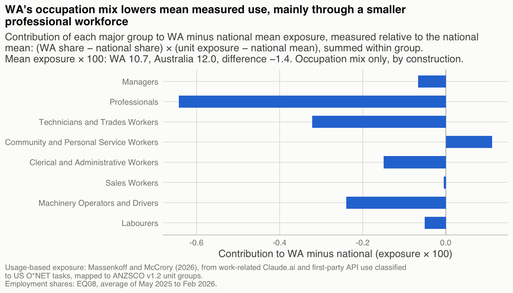
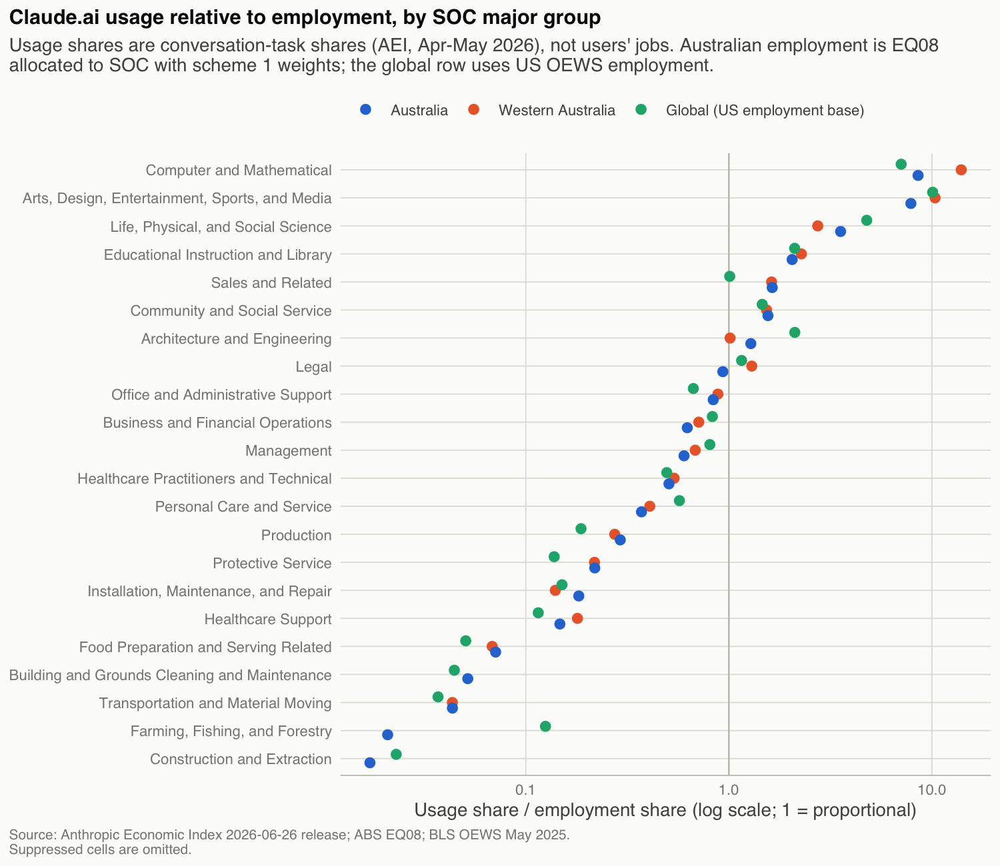

```{r setup}
source("_setup.R")
```

::: {.callout-important}
**Working draft, not for citation.** Descriptive; not a job-loss or career-risk score; not advice.
:::

<!-- LUC: the first paragraph below is required wording from the brief; edit freely but keep its content. -->

The data behind this note are US task-level Claude.ai use by self-selected users, from one product. No Australian occupational AI use is measured. The usage-based exposure scores describe tasks in US occupations; this note applies them to the mix of occupations in Australian employment. Where the source data have Australian rows, those rows classify the task in a conversation, not the user's job. Every result is shown beside at least one measure that does not come from Anthropic.

## Question and framing

<!-- LUC: replace this section with your edited version of docs/drafts/framing_draft.md (sections 1 and 2). -->

*[Luc to write: research question and framing.]*

## Data {#sec-data}

**Usage-based exposure.** The measure is Massenkoff and McCrory's "observed exposure" [@massenkoff2026], published as `job_exposure.csv` in the Anthropic Economic Index dataset [@aei2026cadences]. It gives one score for each US occupation at the six-digit level of the SOC `2018` classification. The file has `r num("je_rows")` rows. Of these, `r num("je_zero")` (`r pc("je_zero_share", 0)`) are exactly zero; the mean is `r num("je_mean", 3)` and the maximum `r num("je_max", 3)`. Another `r num("soc_missing")` of the `r num("soc_total")` detailed SOC occupations have no row, and these are treated as missing, not zero.

The score is built in steps, which matter for reading it:

- Each O*NET task is first gated on use. A task counts only if its work-related Claude.ai conversations plus all first-party API calls reach a fixed count in Anthropic's samples.
- It is then gated on capability: the task must have an Eloundou et al. beta above zero [@eloundou2024].
- Tasks that pass both gates are weighted between one half (augmentation only) and one (automation only).
- The job score is the time-share-weighted sum over the job's tasks.

So a zero means the job's tasks fell below the usage gate, or that none of its used tasks passed the capability gate. It does not mean no use at all. Zeros are flagged as "below usage threshold" wherever unit values are shown. The conversations are classified into US O*NET tasks, and the samples are global Claude.ai and API traffic, not Australian.

**Australian usage composition.** For the comparison of usage with employment by occupation group (@sec-major-group), the note uses the `2026-06-26` release of the AEI geography file. It covers Claude.ai conversations in `r num("aei_months")` months, with `r num("aei_rows_aus")` rows for Australia and `r num("aei_rows_wa")` for Western Australia. For countries and subregions, detailed SOC rows are published only as shares of conversations. Collaboration measures, such as the automation share, exist for countries only at the SOC major-group level. Missing rows mean the cell was not published, not that it was zero.

**Potential exposure.** Three comparison measures do not depend on Claude.ai use:

- Jobs and Skills Australia's automation and augmentation exposure scores for ANZSCO unit groups [@jsa2025], available for `r num("jsa_units")` unit groups;
- Eloundou et al.'s beta, rated by `GPT-4`, averaged from O*NET occupations to SOC codes [@eloundou2024];
- Felten, Raj and Seamans's AIOE [@felten2021]. The AIOE repository states no licence, so AIOE appears only in aggregate statistics and never for a single occupation.

**Employment.** Employment weights come from ABS Labour Force table `EQ08` [@abseq08]. It gives employed persons by ANZSCO `v1.2` unit group, sex and state each quarter. The weights average the `r num("eq08_quarters")` quarters from May `2025` to February `2026`: `r num("emp_total_m", 2)` million people employed, `r num("emp_wa_m", 2)` million of them in Western Australia. `EQ08` was the final release under that title. ABS has said the table is not published from April `2026` [@abs2026lfschanges], and Labour Force occupation data are coded to OSCA from the September `2026` reference period [@abs2026lfmethod]. Neither source states whether unit-group detail will be published.

**Earnings.** Units are ranked by average weekly total cash earnings of all employees in the ABS Employee Earnings and Hours survey, May `2025` (data cube `11`) [@abseeh2025]. No EEH cube gives hourly earnings at unit-group level. Two alternative rankings are reported:

- average hourly total cash earnings of full-time non-managerial adult employees (EEH cube `13`, published only for three-digit minor groups);
- average salary or wage income from ATO Taxation Statistics `2023`-`24`, Table `15B` [@ato2026].

EEH excludes owner-managers; `EQ08` counts everyone employed.

**Crosswalks.** US occupations are linked to ANZSCO through BLS and ABS concordances: SOC `2018` to SOC `2010`, SOC `2010` to `ISCO-08`, and `ISCO-08` to ANZSCO `v1.2`. A fourth weighting scheme uses Jobs and Skills Australia's direct correspondence from ANZSCO `v1.2` to O*NET-SOC `2019`, an archived copy [@jsalmi2024]. Within each unit, US occupations are weighted by employment in the BLS Occupational Employment and Wage Statistics for May `2025` [@blsoews2025].

Every file's source, access date, checksum and licence are recorded in `data/raw/MANIFEST.csv`.

## Methods {#sec-methods}

### Edition spine

The analysis unit is the ANZSCO `v1.2` unit group, because employment by sex and state is published only in that edition. There are `r num("units")` unit groups.

- **nfd codes.** Employment coded only to a broader group ("not further defined") is shared among the unit groups under it, in proportion to their employment in the same quarter, sex and state. These codes hold between `r pc("nfd_share_min")` and `r pc("nfd_share_max")` of employment in each quarter.
- **ANZSCO `v1.3`.** It has exactly the same codes as `v1.2`, so it needs no bridge.
- **ANZSCO `2021` and `2022`.** EEH and ATO use these editions. They are brought back to `v1.2` through the ABS correspondence tables. Of the `r num("bridge_pairs")` unit-to-unit links, `r num("bridge_same")` keep the same code, `r num("bridge_recoded")` are recoded, `r num("bridge_merge")` merge several units into one, `r num("bridge_split")` split one unit across several and `r num("bridge_m2m")` are many-to-many.
- **Merges and splits.** A `v1.2` unit fed by several newer units takes their mean, weighted by ATO individual counts. A newer unit split across several `v1.2` units passes its value to each.
- **Missing earnings.** Units with no published EEH value after bridging (`r num("eeh_imputed")` units) take the employment-weighted mean of their published siblings in the same minor group. Each one is listed in the appendix.

### Usage-based exposure for each unit (method A)

The usage-based exposure of unit $a$ is

$$
e_a = \sum_{s \in S_a} w_{as}\, e_s, \qquad \sum_{s \in S_a} w_{as} = 1,
$$

where $S_a$ is the set of linked US occupations with a non-missing score, and the weights are renormalised over that set. The extensive margin applies the same weights to an indicator of any measured use, $\sum_s w_{as}\,\mathbf{1}[e_s > 0]$. Intensity is exposure divided by the extensive margin.

Four weighting schemes give four versions of every unit value:

1. **OEWS employment weights** on the primary chain. This is the primary scheme.
2. **Equal weights** on the same links.
3. **Title-match-first.** For each ANZSCO occupation, only US occupations whose titles match are kept if any match; otherwise all its links are kept. `r num("s3_occupations")` occupations in `r num("s3_units")` units have a match.
4. **The JSA correspondence links**, with OEWS weights. They cover `r num("s4_units")` units.

The primary chain gives `r num("links1")` unit-to-occupation links through `r num("links1_isco")` `ISCO-08` units. Because `ISCO-08` is coarser than both SOC and ANZSCO, the chain smooths zeros into small positive values. Every unit is therefore graded by how many US occupations feed it:

| Grade | Linked US occupations | Units | Share of employment |
|---|---|---|---|
| One-to-one | one | `r num("grade_n_onetoone")` | `r pc("grade_emp_onetoone")` |
| Few-to-one | two to four | `r num("grade_n_fewtoone")` | `r pc("grade_emp_fewtoone")` |
| Diffuse | five or more | `r num("grade_n_diffuse")` | `r pc("grade_emp_diffuse")` |

Every headline result is rerun on non-diffuse units only.

A second chain, through the ANZSCO `2022` correspondence to `ISCO-08`, gives identical links for `r num("val_identical")` units and different links for `r num("val_differ")`; the appendix lists them. Coverage is the share of employment in units with at least one scored US occupation. It is `r pc("coverage")`, against a target set in advance of `98%`. The `r num("units_unmatched")` unmatched units are listed in the appendix.

### Earnings deciles and concentration (method B)

- **Deciles.** Units are ranked by earnings and cut into employment-weighted deciles, so each decile holds a tenth of employment. A unit whose employment straddles a boundary is split between deciles in proportion. Decile means are employment-weighted. Decile intensity is mean exposure divided by mean extensive margin.
- **Top minus bottom.** The difference between the top and bottom deciles is reported in percentage points, never as a ratio.
- **Concentration index.** $CI = 2\,\mathrm{cov}(e, r)/\bar{e}$, with employment weights, where $r$ is the employment-weighted fractional earnings rank. A positive index means exposure is concentrated among higher earners. It is not reported for AIOE, which is a standardised score with negative values.
- **Sensitivity runs.** Results are rerun excluding units whose EEH relative standard error is above `25%` (`r num("eeh_rse25")` units). They are also rerun excluding a draft list of `r num("owner_manager_units")` owner-operator units. ABS publishes form of employment only by occupation major group [@abswa2025], so the list is a judgement.

### Usage against potential (method C)

For each unit, the usage-potential gap is the percentile rank of usage-based exposure minus the percentile rank of the potential measure.

- Ranks are employment-weighted, and tied values share the mid-rank. In particular, every unit with zero usage-based exposure shares one rank.
- Unit gaps are averaged within deciles, with employment weights.
- A version using weighted z-scores is a check.
- The comparison with Eloundou beta is partly mechanical, because usage-based exposure is itself gated on that beta. It compares use with feasibility inside the same task frame. JSA's scores and AIOE are the independent checks, and JSA automation is the primary comparator.
- The note also reports employment-weighted rank correlations, and the fifteen largest rank disagreements with JSA whose sign is the same under all four schemes.

### Women and men, Western Australia, and usage by occupation group (method D)

- **Women and men.** Deciles come from the persons earnings ranking. Within each decile, exposure is averaged with each sex's employment.
- **Western Australia.** The difference between WA and national mean exposure is
  $$\Delta = \sum_a (s^{WA}_a - s^{AUS}_a)\, e_a,$$
  where $s$ are employment shares. By construction it reflects occupation mix only, since every unit carries one national value. The difference is split by major and sub-major group. Sub-major groups with fewer than five thousand WA workers are not shown separately. No WA by sex results are produced.
- **Usage by occupation group** (@sec-major-group). Each SOC major group's share of Claude.ai conversations is divided by its share of employment.
  - For Australia and WA, employment is `EQ08` allocated to SOC groups with the scheme `1` weights.
  - For the global row, it is US OEWS employment, because no global employment by SOC exists.

### What counts as holding

These rules were fixed before any results were produced.

- **Decile profiles.** A profile holds under a variant if its OLS slope across deciles has the same sign as the primary profile, and the Spearman correlation of the two sets of decile means is at least `0.7`.
- **The gap.** The gap holds if its sign in the top and bottom quintiles is the same under every weighting scheme.
- **Reporting.** Every specification is reported, including those that do not hold. There are `r num("specs")`: four schemes, four samples and three earnings rankings.

## Results

<!-- LUC: write each takeaway in the marked spaces. The figure captions only describe what is plotted. -->

### The usage-potential gap by earnings decile

{#fig-gap}

*[Luc to write: takeaway for @fig-gap.]*

### Extensive margin and intensity

{#fig-margins}

*[Luc to write: takeaway for @fig-margins.]*

### Concentration

{#fig-curves width="75%"}

*[Luc to write: takeaway for @fig-curves.]*

### Where usage and JSA disagree

{#fig-scatter width="85%"}

*[Luc to write: takeaway for @fig-scatter.]*

### Women and men, and Western Australia

{#fig-sex}

{#fig-wa}

*[Luc to write: takeaways for @fig-sex and @fig-wa.]*

### Usage relative to employment by occupation group {#sec-major-group}

{#fig-index}

*[Luc to write: takeaway for @fig-index.]*

### Robustness

Of the `r num("specs")` specifications, `r num("specs_hold")` hold against the primary profile under the rule above. Under scheme `4`, `r num("specs_hold_s4")` of `r num("specs_s4")` hold. One unit accounts for this: Sales Assistants (General), which has `r pc("emp_share_6211")` of employment, most of it in the bottom decile. Under scheme `4` it links only to US Retail Salespersons, one of the score's known artefacts. Leaving it out moves the scheme `4` top-minus-bottom difference from `r pp("s4_tmb")` to `r pp("s4_tmb_no6211")`. This check was added after the first results were seen, and is reported as such. The full sensitivity table is in the appendix.

*[Luc to write: takeaway on robustness.]*

::: {.callout-note}
## Theory box

*[Luc to write: one page relating these patterns to the two-capital model. Claude checks the algebra only.]*
:::

## Limitations {#sec-limitations}

**The usage data come from one product and its users.** Claude.ai and Anthropic's API serve a self-selected group of users. JSA reports that Claude.ai has under three per cent of Australian market share [@jsa2025, pp. 35-36]. Usage-based scores built from one platform mix how applicable AI is to a task with who happens to use that platform [@yinogut2026]. Nothing in the note measures how Australian workers in a given occupation use AI.

**Tasks, not jobs.** The source classifies the task in each conversation, not the job of the person having it. A conversation about nutrition is not evidence that a nutritionist was involved. The Australian rows used in @sec-major-group carry the same caveat.

**Zeros and gates.** Over half of the scored US occupations have a score of exactly zero. A zero can mean the occupation's tasks fell below the usage gate in Anthropic's sample, or that its used tasks failed the capability gate. Because of that gate, the comparison with Eloundou beta is partly mechanical.

**Known artefacts.** Some scores sit oddly beside related occupations:

| US occupation | Score | Related occupation | Score |
|---|---|---|---|
| Legal Secretaries and Administrative Assistants | zero | Paralegals and Legal Assistants | positive |
| Bartenders | zero | | |
| Retail Salespersons | higher | Lawyers | lower |

These pass through the crosswalk unchanged. The Retail Salespersons score dominates the result for Sales Assistants (General) under scheme `4`.

**Crosswalk smoothing.** The primary chain passes through `ISCO-08`, which is coarser than either end. Units fed by five or more US occupations hold `r pc("grade_emp_diffuse")` of employment. Results on non-diffuse units are reported beside the main results in the appendix.

**Earnings.** Ranking by earnings needs a few compromises:

- Weekly earnings mix hourly pay with hours worked. No hourly earnings are published at unit-group level.
- EEH leaves out owner-managers, while `EQ08` counts them.
- `r num("eeh_imputed")` units have no published EEH value and take their minor group's mean. `r num("eeh_rse25")` units have relative standard errors above `25%`.
- In the ATO data, `r pc("ato_unmapped_share")` of individuals have a blank or unclassifiable occupation code. Of these, `r pc("ato_blank_share")` of all individuals are blank.

**Sampling error.** `EQ08` publishes no standard errors. Unit-level employment, especially for Western Australia, is estimated with error that this note cannot show.

**Timing.** The four sources cover different periods:

| Source | Period |
|---|---|
| Usage-based scores | Anthropic conversation samples collected before the score was published in March `2026` |
| Australian usage shares | April and May `2026` |
| Employment | May `2025` to February `2026` |
| Earnings | May `2025` (EEH) and `2023`-`24` (ATO) |

**Occupation-group shares.** The published SOC major-group shares do not sum to one hundred per cent for any geography, even where all groups are published. The data documentation does not say what fills the gap.

**What the note does not do.** It describes; it does not estimate effects. It says nothing about employment, wages or hours responding to AI. It measures variation between occupations, not within them. It is not a forecast and not a job-loss or career-risk score.

## What did not work, and changes along the way

- **The questions file.** A separate file of research questions and choices was dropped on `25` October `2026`. The method choices it would have held were logged in `decision_log.md` before any results were produced. The research question and framing were drafted after the first results.
- **Hourly earnings.** These were the intended primary ranking but are not published at unit-group level. Weekly earnings are used instead.
- **Owner-managers.** No unit-level data on owner-managers exist in published ABS tables, so that sensitivity run uses a judgement list.
- **The concentration index for AIOE** was dropped, for the reason given in @sec-methods.
- **The JSA correspondence** turned out to be coded to ANZSCO `v1.2`, not `v1.3` as its archived web page implied.
- **Weighting scheme `4`** does not reproduce the primary decile profile. The influence check that explains it was added after the results were seen.
- **The JSA automation gap** does not keep its sign in the bottom quintile across schemes.
- **Rebuilding the usage-based score** from the published task data, with O*NET task weights in place of the unpublished time shares, gave a rank correlation with the published scores below the target of `0.9` (appendix).

## Contributions and AI use

<!-- LUC: this paragraph describes the finished note; it becomes true once your sections are in. -->

Luc Taya chose the topic and data sources, made the judgement calls, edited the research question and framing, and wrote the interpretation, every takeaway and the theory box. Claude Code, an AI coding assistant, wrote the data pipeline under Luc's direction and drafted the data, methods, limitations and appendix sections for Luc to edit. The data analysed are published by Anthropic, and the pipeline was written with Claude Code, an Anthropic product. Anthropic had no role in this project and has not reviewed or endorsed it.

## Credits

This note includes information from the O*NET `31.0` Database by the U.S. Department of Labor, Employment and Training Administration (USDOL/ETA). Used under the CC BY `4.0` license. O*NET® is a trademark of USDOL/ETA. Luc Taya has modified all or some of this information. USDOL/ETA has not approved, endorsed, or tested these modifications.

Australian Bureau of Statistics data are used under CC BY `4.0`. ATO data are used under CC BY `2.5` AU. Jobs and Skills Australia material is © Commonwealth of Australia, used under CC BY `4.0`. Full credits and licences are in `docs/credits.md`.

## References {.unnumbered}

::: {#refs}
:::
