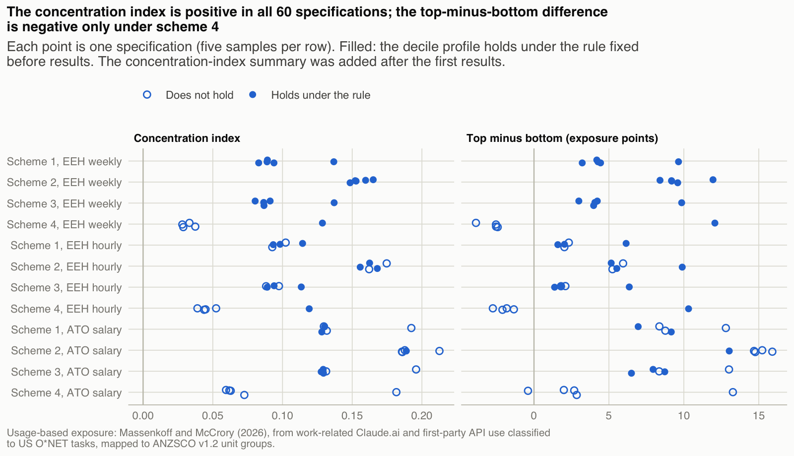
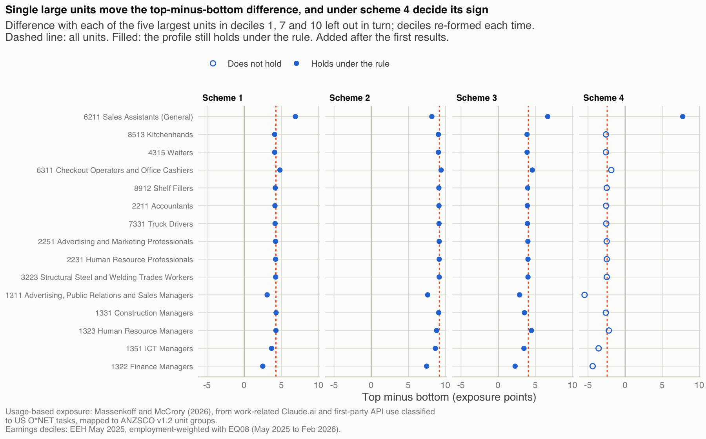

```{r setup}
source("_setup.R")
library(tidyr)
tab <- function(d, ...) kable(d, ..., format = "pipe")
```

::: {.callout-important}
**Working draft `v0.9`, comments welcome.** Descriptive; not a job-loss or career-risk score; not advice.
:::

## Abstract {.unnumbered}

Australian monitoring of generative AI relies on measures of what AI could do. This note asks where measured use sits in the earnings distribution. The usage data are task-level Claude.ai and first-party API use by self-selected users of one provider, classified to US O\*NET tasks; no Australian occupational AI use is measured. I map Massenkoff and McCrory's [-@massenkoff2026] observed exposure onto `r num("units")` ANZSCO unit groups through official concordances, weight by Australian employment and rank units by earnings. Measured use is concentrated in higher-earning occupations: the concentration index is `r num("ci_usage", 3)` and is positive in all `r num("specs")` specifications reported. The gradient is modest and hump-shaped. Mean exposure is `r num("usage_d1", 3)` in the bottom decile, peaks at `r num("usage_max", 3)` in decile `r num("usage_max_decile")` and is `r num("usage_d10", 3)` in the top decile; the bottom-to-top difference depends on single units and changes sign under one of four crosswalks. Whether any linked task shows measured use, the extensive margin, accounts for more than the whole bottom-to-top difference. Ranked against capability measures, measured use places low earners' occupations higher and high earners' lower; against Jobs and Skills Australia's automation scores it places the top quintile higher. Women's occupations show more measured use than men's in every earnings decile, and Western Australia's occupation mix lowers its mean by `r n(-100 * fact("wa_rel_usage"))` per cent. Nothing here measures how Australian workers use AI.

*JEL:* `J24`, `J31`, `O33`. *Keywords:* generative AI; occupational exposure; earnings distribution; crosswalks; Australia.

**Key findings**

1. **Concentration is robust.** The concentration index of usage-based exposure is `r num("ci_usage", 3)` and is positive in all `r num("specs")` specifications (`r num("ci_spec_min", 3)` to `r num("ci_spec_max", 3)`). A rank-based index, comparable across measures, is positive in all of them too.
2. **The shape is not.** Exposure rises from `r num("usage_d1", 3)` in the bottom decile to a peak of `r num("usage_max", 3)` in decile `r num("usage_max_decile")` and is `r num("usage_d10", 3)` at the top. The bottom-to-top difference of `r num("tmb_pp", 1)` points ranges from `r num("inf_s1_tmb_min", 1)` to `r num("inf_s1_tmb_max", 1)` when single large units are left out, and is negative under the crosswalk built on JSA's direct correspondence.
3. **The gradient runs through the extensive margin.** The share of linked US occupations with any measured use rises from `r num("ext_d1", 2)` to `r num("ext_d10", 2)`; use conditional on any use is lower at the top than at the bottom.
4. **Measured use sits between two families of potential measures.** On a rank basis it is less concentrated among high earners than capability measures (JSA augmentation, Eloundou et al.'s beta, AIOE) and more concentrated than JSA's automation scores.
5. **Composition.** Women's occupations show more measured use than men's in every decile (`r num("usage_women", 3)` against `r num("usage_men", 3)`). WA's occupation mix lowers its mean by `r n(-100 * fact("wa_gap_usage"), 1)` points (`r n(-100 * fact("wa_rel_usage"))` per cent).

**What this note is not.** It is descriptive. Scores describe US occupations' tasks and are applied to Australia's occupation mix, so every comparison is between occupations, not within them. Every result is shown beside a measure that does not come from Anthropic, except the conversation shares in @sec-major-group.

## Introduction {#sec-intro}

Australia monitors generative AI through measures of potential. Jobs and Skills Australia [JSA, -@jsa2025] scores every ANZSCO unit group for how far generative AI could automate or augment its tasks. The Department of Employment and Workplace Relations [DEWR, -@dewr2026] uses the automation scores to ask whether exposed occupations have grown more slowly since ChatGPT's release: employment in the most exposed fifth of occupations grew `5.6` per cent between November `2022` and February `2026`, against `9.5` per cent in the least exposed fifth. With Massenkoff and McCrory's observed exposure in place of JSA's scores, DEWR's estimate is near zero and not significant [@dewr2026, p. 52]. Single Touch Payroll data show the weakest hiring in clerical and administrative occupations [@gross2026]. What these measures cannot say is where AI is actually used. That is a prior question for monitoring, and for distributional questions such as how AI-driven wage changes would fall across the tax base, where current scenarios assume an even spread across the income distribution [@nolanrankin2026].

This note maps a usage-based measure onto Australian occupations and asks two questions. How is measured use distributed across Australia's earnings distribution? And where does it rank occupations higher or lower than measures of potential do? The usage measure is Massenkoff and McCrory's [-@massenkoff2026] observed exposure: the time-weighted share of an occupation's tasks that pass a capability gate and show sufficient work-related use of Claude. I link its `r num("je_rows")` US occupations to the `r num("units")` ANZSCO `v1.2` unit groups through BLS and ABS concordances (`r num("units_covered")` of them receive a score), grade every unit by how many US occupations feed it, run four weighting schemes and report every specification, including those that fail rules fixed before results were produced.

Four findings stand out. First, measured use is concentrated among higher earners. The concentration index is `r num("ci_usage", 3)` in the main specification and positive in all `r num("specs")` specifications. Second, the gradient is modest and hump-shaped: mean exposure rises from `r num("usage_d1", 3)` in the bottom decile to `r num("usage_max", 3)` in decile `r num("usage_max_decile")` and falls to `r num("usage_d10", 3)` in the top decile. That shape is consistent with Handa et al.'s [-@handa2025] finding that Claude use peaks in occupations in the upper wage quartile and is lower at both extremes, but in these data the shape itself is fragile: leaving single large units out moves the bottom-to-top difference between `r num("inf_s1_tmb_min", 1)` and `r num("inf_s1_tmb_max", 1)` points, and it is negative under the crosswalk built on JSA's direct correspondence. Third, the gradient runs through the extensive margin. The share of linked US occupations with any measured use rises from `r num("ext_d1", 2)` to `r num("ext_d10", 2)` between the bottom and top deciles, while use conditional on any use is lower at the top. Fourth, on a rank basis measured use is less concentrated among high earners than capability-based measures (JSA's augmentation scores, Eloundou et al.'s [-@eloundou2024] beta and Felten et al.'s [-@felten2021] AIOE): it ranks the bottom quintile's occupations higher and the top quintile's lower than they do, under every scheme. Relative to JSA's automation scores, the primary comparator, it ranks the top quintile higher under every scheme; the bottom-quintile comparison is not robust. Two composition results follow: women's occupations show more measured use than men's in every earnings decile, and Western Australia's occupation mix lowers its mean by `r n(-100 * fact("wa_rel_usage"))` per cent.

The note joins three literatures. The first measures AI use from platform logs [@handa2025; @tomlinson2025; @chatterji2025; @massenkoff2026]. In US data, workers in the most exposed quarter of occupations earn `47` per cent more than workers with zero exposure [@massenkoff2026]. Within the capability envelope, however, whether work already runs through a computer predicts use better than wages do [@levkoff2026], and Copilot-based applicability is only weakly correlated with occupational wages [@tomlinson2025]. Platform logs also reflect who uses each platform: changing only the platform input moves estimated employment effects by a factor of `1.9`, and Claude.ai and Anthropic's first-party API give coefficients of opposite sign [@yinogut2026]. That caveat applies with force here. The second literature maps US exposure measures onto other countries' occupational structures [@pizzinelli2023; @cazzaniga2024; @gmyrek2025; @murugan2026]. Through occupational composition, women are more exposed than men in `126` of `138` countries [@murugan2026], and US task content applies imperfectly abroad [@lewandowski2022]. The third concerns Australia: technological change and earnings inequality [@coelliborland2016; @borlandcoelli2017], the potential-based monitoring above, and two uses of Anthropic data with ANZSCO. DEWR [-@dewr2026] uses observed exposure as an alternative measure in its employment model, and Demirev [-@demirev2026] maps an earlier usage score through three-digit ISCO to study job postings. Neither examines earnings.

To my knowledge, the note adds four things: (i) the distribution of measured use across employment-weighted Australian earnings deciles, with concentration indices and rank gaps against four potential measures; (ii) a decomposition of that distribution into an extensive margin and intensity; (iii) Western Australia and women and men, by occupation mix; (iv) a crosswalk graded unit by unit and run under four weighting schemes, with every specification reported whether or not it holds. The note moves from what AI could be used for to what it is being used for. It does not move to labour-market outcomes and makes no causal claims.

## Data {#sec-data}

### Usage-based exposure

Massenkoff and McCrory [-@massenkoff2026] publish observed exposure for `r num("je_rows")` six-digit SOC `2018` occupations, as `job_exposure.csv` in the Anthropic Economic Index dataset [@aei2026cadences]. Usage comes from the August and November `2025` Economic Index samples: work-related Claude.ai conversations and first-party API traffic, classified to US O\*NET tasks. A task is covered if its work-related usage passes a fixed threshold and its Eloundou et al. beta is positive. Covered tasks are weighted by a factor that runs from one half (augmentative use only) to one (automated use only), and the occupation score is the time-fraction-weighted sum over its tasks, with time fractions from earlier Anthropic work. Of the `r num("je_rows")` scores, `r num("je_zero")` (`r pc("je_zero_share", 0)`) are exactly zero; the unweighted mean is `r num("je_mean", 3)` and the maximum `r num("je_max", 3)` (Computer Programmers). Weighted by US employment (OEWS, May `2025`), the mean is `r num("je_mean_us_weighted", 3)`, and `r pc("je_zero_us_emp_share", 0)` of US employment in scored occupations is at exactly zero. The other `r num("soc_missing")` of the `r num("soc_total")` detailed SOC occupations have no score and are treated as missing, not zero.

A zero means that an occupation's tasks fell below the usage threshold in Anthropic's samples, or that none of its used tasks passed the capability gate. It does not mean no use. Zeros are flagged wherever unit values appear.

### Australian usage composition

For @sec-major-group I use the `2026-06-26` release of the Economic Index geography file: Claude.ai conversations in April and May `2026`, with `r num("aei_rows_aus")` rows for Australia and `r num("aei_rows_wa")` for Western Australia. Detailed SOC rows for countries and subregions are published only as shares of conversations, and collaboration measures only at SOC major-group level. Missing rows are suppressed cells, not zeros. The rows classify the task in a conversation, not the user's job.

### Potential exposure

Three families of comparison measures use no Claude data. JSA's automation and augmentation scores cover `r num("jsa_units")` ANZSCO unit groups. JSA built them by adapting the method of Gmyrek et al. [-@gmyrek2023] to Australian occupations' tasks, with separate scores for tasks generative AI could undertake (automation) or assist with (augmentation) [@jsa2025]; DEWR [-@dewr2026, Appendix A] describes the task scoring as a judgement by a large language model. Being native to ANZSCO, they need no crosswalk, and the automation scores are the measure DEWR uses for monitoring; JSA automation is therefore the primary comparator. Eloundou et al.'s beta, rated against early-`2023` capabilities by `GPT-4`, is averaged from O\*NET occupations to SOC codes. JSA's scores and beta both rest on language-model ratings of tasks, and observed exposure is gated on beta, so comparisons with beta are partly mechanical. Felten et al.'s AIOE (the original `2021` version, not the language-model variant) links AI applications to occupational abilities through a survey and shares no inputs with the other measures. Its repository states no licence, so it appears only in aggregate statistics.

### Employment and earnings

Employment weights come from ABS Labour Force table `EQ08` [@abseq08], which gives employed persons by ANZSCO `v1.2` unit group, sex and state each quarter. I average the `r num("eq08_quarters")` quarters from May `2025` to February `2026`: `r num("emp_total_m", 2)` million employed, `r num("emp_wa_m", 2)` million of them in Western Australia. `EQ08` is not published from April `2026` [@abs2026lfschanges], and Labour Force occupation data are coded to OSCA from the September `2026` reference period [@abs2026lfmethod].

Units are ranked by average weekly total cash earnings of all employees in the ABS Employee Earnings and Hours survey, May `2025`, data cube `11` [@abseeh2025]. No EEH cube gives hourly earnings at unit-group level. Two alternative rankings appear in the appendix: average hourly total cash earnings of full-time non-managerial adult employees (EEH cube `13`, three-digit minor groups only, so the `r num("eeh13_missing")` chief executive, general manager and legislator units have no value) and average salary or wage income from ATO Taxation Statistics `2023`--`24`, Table `15B` [@ato2026]. EEH excludes owner-managers, whom `EQ08` counts.

### Crosswalks

US occupations are linked to ANZSCO through SOC `2018` → SOC `2010` → `ISCO-08` (BLS concordances) → ANZSCO `v1.2` (ABS concordance). A fourth weighting scheme uses JSA's direct correspondence from ANZSCO `v1.2` to O\*NET-SOC `2019` [@jsalmi2024]. Within each unit, US occupations are weighted by May `2025` OEWS employment [@blsoews2025]. Every file's source, access date, checksum and licence is recorded in `data/raw/MANIFEST.csv`.

## Methods {#sec-methods}

**Main specification.** Weighting scheme `1`, all unit groups, EEH weekly earnings and JSA automation as the primary comparator. Each choice was set on `25` October `2026`, before any result was produced, and recorded in `decision_log.md`. Every alternative is in the appendix.

### Edition spine

The unit of analysis is the ANZSCO `v1.2` unit group (`r num("units")` units), the only edition with employment by sex and state. Employment coded "not further defined" (`r pc("nfd_share_min")` to `r pc("nfd_share_max")` of each quarter) is shared among the unit groups beneath it in proportion to their employment in the same quarter, sex and state. ANZSCO `v1.3` has the same codes as `v1.2`. EEH and ATO data, coded to ANZSCO `2021` and `2022`, are bridged back through ABS correspondences: of `r num("bridge_pairs")` unit-to-unit links, `r num("bridge_same")` keep their code, `r num("bridge_recoded")` are recoded, `r num("bridge_merge")` merge several units, `r num("bridge_split")` split one unit and `r num("bridge_m2m")` are many-to-many. A merged unit takes the ATO-count-weighted mean of its sources; a split unit passes its value to each child. The `r num("eeh_imputed")` units without a published EEH value take the employment-weighted mean of their minor group; each is listed in the appendix.

### Usage-based exposure for each unit {#sec-unit}

The usage-based exposure of unit $a$ is
$$
e_a = \sum_{s \in S_a} w_{as}\, e_s, \qquad \sum_{s \in S_a} w_{as} = 1,
$$
where $S_a$ is the set of linked US occupations with a score and the weights are renormalised over that set. Renormalising assigns unscored US occupations the mean of the scored ones in the same unit. This matters where unscored occupations dominate: Aged and Disabled Carers takes its value from two supervisory occupations because its main counterparts, Home Health Aides and Personal Care Aides, have no score. A lower bound that counts unscored links as zero is reported alongside. The extensive margin applies the same weights to an indicator of any measured use, $m_a = \sum_s w_{as}\mathbf{1}[e_s > 0]$, and intensity is $i_a = e_a/m_a$. As a capability analogue that uses no Claude data, the same weights applied to $\mathbf{1}[\beta_s > 0]$ give the share of linked US occupations that any language model could assist.

Four weighting schemes give four versions of every unit value: scheme 1, US employment weights on the primary chain (main); scheme 2, equal weights on the same links; scheme 3, title-match-first, which keeps only the US occupations whose titles match an ANZSCO occupation's title, where any match (titles match when their word sets are equal or their Jaccard similarity is at least `0.75`; `r num("s3_occupations")` occupations in `r num("s3_units")` units match); and scheme 4, JSA's correspondence links with US employment weights (`r num("s4_units")` units have links, `r num("s4_units_scored")` of them a scored link).

The primary chain has `r num("links1")` unit-to-occupation links through `r num("links1_isco")` `ISCO-08` units. Because `ISCO-08` is coarser than both SOC and ANZSCO, the chain averages zeros with positive scores: `r pc("je_zero_us_emp_share", 0)` of US employment in scored occupations is at zero, but units with exactly zero exposure hold only `r pc("zero_emp_share")` of Australian employment. Every unit is therefore graded by how many US occupations feed it (@tbl-grades) and carries the share of its linked US employment that is unscored; `r num("unscored_units")` units, with `r pc("unscored_emp")` of employment, have a majority unscored. A second chain through the ANZSCO `2022` correspondence gives identical links for `r num("val_identical")` units and different links for `r num("val_differ")`. Coverage, the share of employment in units with at least one scored link, is `r pc("coverage")` against a target of `98%` set in advance; the main omission is Education Aides.

| Grade | Linked US occupations | Units | Share of employment |
|---|---|---|---|
| One-to-one | one | `r num("grade_n_onetoone")` | `r pc("grade_emp_onetoone")` |
| Few-to-one | two to four | `r num("grade_n_fewtoone")` | `r pc("grade_emp_fewtoone")` |
| Diffuse | five or more | `r num("grade_n_diffuse")` | `r pc("grade_emp_diffuse")` |

: Crosswalk grades. {#tbl-grades}

### Earnings deciles and concentration {#sec-conc-method}

Units are ranked by earnings and cut into employment-weighted deciles; a unit straddling a boundary is split in proportion. A unit's earnings rank is the mid-point of its block of cumulative employment. Decile means are employment-weighted, and decile intensity is mean exposure divided by mean extensive margin. Differences in exposure are reported in exposure points (exposure × `100`), computed from unrounded values; differences in ranks are in percentile points.

The concentration index is $CI = 2\,\mathrm{cov}_w(e, r)/\bar{e}$, where $r$ is the employment-weighted fractional earnings rank and $\bar{e}$ the employment-weighted mean. A positive index means exposure is concentrated among higher earners. The level index scales with each measure's mean and dispersion, so it does not compare measures. For comparisons across measures I use the rank index $CI_R = 4\,\mathrm{cov}_w(R_m, r)$, where $R_m$ is the employment-weighted rank of measure $m$; without ties it equals one third of the weighted Spearman correlation between the measure and earnings. For measures bounded between zero and one I also report the Erreygers index $4\bar{e}\,CI$ [@erreygers2009]. The rank and Erreygers indices were added after the first results.

### Usage against potential {#sec-gap-method}

For each unit, the usage-potential gap is the employment-weighted percentile rank of usage-based exposure minus that of the potential measure, averaged within deciles or quintiles with employment weights. Two properties govern how it reads. Because both ranks average fifty over employment, the gaps average zero: the profile shows where usage ranks occupations relatively higher or lower, not whether use runs ahead of potential in any absolute sense. And all units with zero exposure share one mid-rank (about `r n(50 * fact("zero_emp_share"))`), so a zero unit's gap is set by its potential rank alone. Gaps with zero units left out are reported alongside.

### Women and men, Western Australia and occupation groups {#sec-comp-method}

Deciles for women and men come from the persons earnings ranking; within each decile, exposure is averaged with each sex's employment. The difference between women and men is split into a within-decile part (women and men in the same decile work in different occupations) and a between-decile part (they are spread differently across deciles), using average shares so the parts add up. The difference between WA and national mean exposure is
$$
\Delta = \sum_a \left(s^{WA}_a - s^{AUS}_a\right) e_a,
$$
where $s$ are employment shares. Because every unit carries one national value, $\Delta$ reflects occupation mix only. Major-group contributions are measured relative to the national mean, $C_g = \sum_{a\in g}(s^{WA}_a - s^{AUS}_a)(e_a - \bar{e}^{AUS})$, so they do not depend on the level of $e$ [@oaxacaransom1999; @yun2005]. For usage by occupation group, each SOC major group's share of Claude.ai conversations is divided by its share of employment, as in Handa et al. [-@handa2025]. Australian and WA employment is `EQ08` allocated to SOC groups with scheme `1` weights; the global row uses US OEWS employment, as no global employment by SOC exists.

### What counts as holding {#sec-holding}

These rules were fixed before any results were produced. A decile profile holds under a variant if its OLS slope across deciles has the main profile's sign and the Spearman correlation of the two sets of decile means is at least `0.7`. The usage-potential gap holds if its sign in the top and bottom quintiles is the same under every weighting scheme. Summaries added after the first results are labelled as such: the sign of the concentration indices across specifications, the influence of single units, the lower bound for unscored links and the gaps without zero units.

## Results {#sec-results}

### Measured use across the earnings distribution {#sec-dist}

{#fig-margins}

Mean usage-based exposure is `r num("usage_d1", 3)` in the bottom decile and `r num("usage_d10", 3)` in the top, a difference of `r num("tmb_pp", 1)` points (@fig-margins). The profile is hump-shaped rather than monotone: it peaks at `r num("usage_max", 3)` in decile `r num("usage_max_decile")` and is high again in decile `r num("usage_second_decile")` (`r num("usage_second", 3)`). A smoothed profile over earnings percentiles, which does not depend on decile boundaries, also peaks in the upper-middle of the distribution (appendix). This is consistent with the US pattern in Claude data, where use peaks in the upper wage quartile and is lower at both extremes [@handa2025], and it peaks lower in the distribution than Webb's [-@webb2020] patent-based measure, which is highest at about the ninetieth wage percentile.

The extensive margin rises from `r num("ext_d1", 2)` to `r num("ext_d10", 2)` (@tbl-margins). Intensity varies between `r num("int_min", 2)` and `r num("int_max", 2)` with no monotone pattern and is lower in the top decile than in the bottom. In logs, the extensive margin accounts for `r n(100 * fact("margin_ext_share"))` per cent of the bottom-to-top difference and intensity for `r fmt(100 * fact("margin_int_share"), digits = 0)` per cent. Across the earnings distribution, measured use differs mainly in whether linked tasks show any use at all, not in how heavily they are used. Both the usage threshold and the crosswalk shape this margin: in units fed by four or fewer US occupations, bottom-decile exposure is `r num("ext_nd_d1", 3)` rather than `r num("usage_d1", 3)` (@sec-robust). The capability analogue rises far less: the share of linked US occupations with a positive beta is `r num("beta_ext_d1", 2)` in the bottom decile and `r num("beta_ext_d10", 2)` in the top.

```{r tbl-margins}
#| tbl-cap: "The bottom-to-top difference runs through the extensive margin. Main specification; $\\ln(e_{10}/e_1)=\\ln(m_{10}/m_1)+\\ln(i_{10}/i_1)$, computed from unrounded decile means."
dp <- m3("decile_profiles.csv") |> filter(scheme == "s1", sample == "all", ranking == "eeh") |> arrange(decile)
mg <- m3("margin_decomposition.csv") |> filter(decile == 10)
tibble(` ` = c("Usage-based exposure $e$", "Extensive margin $m$", "Intensity $e/m$"),
       `Decile 1` = fmt(c(dp$usage[1], dp$extensive[1], dp$intensity[1]), digits = 3),
       `Decile 10` = fmt(c(dp$usage[10], dp$extensive[10], dp$intensity[10]), digits = 3),
       `Log difference` = fmt(c(mg$total, mg$extensive, mg$intensity), digits = 3),
       `Share of total (%)` = fmt(c(100, 100 * mg$extensive_share, 100 * mg$intensity_share), digits = 0)) |>
  tab(align = "lrrrr")
```

### Concentration {#sec-conc}

{#fig-curves width="72%"}

The concentration index of usage-based exposure is `r num("ci_usage", 3)` (@fig-curves). It is positive in each of the `r num("specs")` specifications in the appendix, from `r num("ci_spec_min", 3)` to `r num("ci_spec_max", 3)` (@fig-specs), and so is the rank index (`r num("rank_ci_spec_min", 3)` to `r num("rank_ci_spec_max", 3)`). Because it summarises the whole distribution, it depends less on single deciles than the top-minus-bottom difference does.

The measures are compared on ranks (@tbl-ci). Usage-based exposure (`r num("rank_ci_usage", 3)`) is more concentrated among high earners than JSA automation (`r num("rank_ci_jsa_automation", 3)`), and less than JSA augmentation (`r num("rank_ci_jsa_augmentation", 3)`), beta (`r num("rank_ci_beta_gpt4", 3)`) and AIOE (`r num("rank_ci_aioe", 3)`). The Erreygers indices order the bounded measures the same way. The level indices do not: JSA augmentation's level index (`r num("ci_jsa_augmentation", 3)`) is below usage's because its mean is high relative to its spread, not because it is less related to earnings.

```{r tbl-ci}
#| tbl-cap: "Concentration among higher earners, by measure. Main specification, EEH weekly ranking. The level index does not compare measures; the rank and Erreygers indices do. AIOE takes negative values, so only its rank index is defined. Rank and Erreygers indices added after the first results."
ci <- m3("concentration_indices.csv")
lab <- c(usage = "Usage-based exposure", jsa_automation = "JSA automation (primary)", jsa_augmentation = "JSA augmentation",
         beta_gpt4 = "Eloundou et al. beta", aioe = "AIOE")
ci |> filter(measure %in% names(lab)) |> mutate(measure = factor(lab[measure], levels = lab)) |> arrange(measure) |>
  transmute(Measure = measure, Mean = if_else(measure == "AIOE", "", fmt(mean, digits = 3)),
            `Level index` = if_else(is.na(ci), "", fmt(ci, digits = 3)), `Rank index` = fmt(rank_ci, digits = 3),
            `Erreygers index` = if_else(is.na(erreygers), "", fmt(erreygers, digits = 3))) |>
  tab(align = "lrrrr")
```

### Measured use relative to potential {#sec-gap}

{#fig-gap}

Against the primary comparator, JSA automation, usage-based exposure ranks the top earnings quintile's occupations `r num("gapq5_jsa_automation", 1)` points higher, and the sign holds under all four schemes (@tbl-gaps). It ranks the bottom quintile's occupations `r ab("gapq1_jsa_automation")` points lower under scheme `1`, but `r num("gapq1_s4_jsa_automation", 1)` points higher under scheme `4`, so the bottom-quintile result fails the rule. Against the capability family the pattern reverses and is robust. Relative to JSA augmentation, beta and AIOE, usage ranks the bottom quintile `r num("gapq1_jsa_augmentation", 1)`, `r num("gapq1_beta_gpt4", 1)` and `r num("gapq1_aioe", 1)` points higher and the top quintile `r ab("gapq5_jsa_augmentation")`, `r ab("gapq5_beta_gpt4")` and `r ab("gapq5_aioe")` points lower, with both signs stable across schemes. AIOE shares no inputs with observed exposure, so the pattern is not an artefact of the capability gate; consistent with that, AIOE's rank correlation with usage (`r num("rho_aioe", 2)`) is as high as beta's (`r num("rho_beta_gpt4", 2)`). Leaving out zero-exposure units, whose shared rank sets their gaps, keeps every sign (appendix).

Measured use therefore sits between the two families: more concentrated among high earners than JSA's automation potential, less concentrated than capability measures. Decile-level gaps are noisy (the scheme range against JSA automation in decile `1` spans `r num("gap_d1_jsa_range", 0)` points), and because the gaps average zero, a positive gap at the bottom implies negative gaps elsewhere.

```{r tbl-gaps}
#| tbl-cap: "Usage-potential rank gap in the bottom and top earnings quintiles. Mean rank gap in percentile points, EEH weekly ranking, all units. Only the bottom-quintile gap against JSA automation changes sign across schemes, so it fails the rule; all other signs hold."
gq <- m3("gap_quintiles.csv") |> filter(sample == "all", ranking == "eeh")
plab <- c(jsa_automation = "JSA automation (primary)", jsa_augmentation = "JSA augmentation", beta_gpt4 = "Eloundou et al. beta", aioe = "AIOE")
gq |> mutate(potential = factor(plab[potential], levels = plab), scheme = sub("s", "Scheme ", scheme)) |>
  select(potential, scheme, Bottom = gap_rank_q1, Top = gap_rank_q5) |>
  pivot_longer(c(Bottom, Top)) |> mutate(value = fmt(value, digits = 1)) |>
  pivot_wider(names_from = c(scheme, name), values_from = value, names_sep = ": ") |>
  arrange(potential) |> rename(`Potential measure` = potential) |>
  tab(align = "lrrrrrrrr")
```

### Where usage and JSA automation disagree {#sec-disagree}

{#fig-scatter width="85%"}

Across units, usage-based exposure and JSA automation are positively rank-correlated (`r num("rho_jsa_automation", 2)`, employment-weighted; @fig-scatter). Of the `r num("dis_n")` largest disagreements whose sign holds under every scheme, `r num("dis_negative")` are units that usage ranks below JSA: clerical units (betting, transport and despatch, purchasing and supply logistics, bank workers, payroll), driving units (delivery, bus and coach, train and tram) and hospitality management. `r Words(fact("dis_negative_zero"))` of them have exactly zero exposure, so their rank is the tied rank and their gap is set by JSA alone. The `r words(fact("dis_n") - fact("dis_negative"))` units usage ranks above JSA are photographers, visual arts and crafts professionals and electrical distribution trades workers; the last falls from `r num("dis_3422_s1", 0)` to `r num("dis_3422_s4", 0)` points under the JSA correspondence. Ranked instead by their contribution to employment-weighted gaps, the largest disagreements are larger units (appendix).

The clerical disagreements matter for monitoring. Australian payroll data show the weakest hiring since ChatGPT's release in clerical and administrative occupations, among them accounting, payroll and general clerks [@gross2026], yet usage-based exposure ranks payroll clerks `r ab("dis_5513_s1", 0)` points below JSA. One reading is that much clerical automation runs through enterprise software rather than chat interfaces, which conversation logs see poorly. On this evidence, usage-based and potential measures complement each other in monitoring; neither substitutes for the other.

### Women and men {#sec-sex}

{#fig-sex}

Women's employment-weighted usage-based exposure is `r num("usage_women", 3)` and men's `r num("usage_men", 3)`, and women's is higher in all `r num("deciles_women_higher")` deciles (@fig-sex). Differences within deciles account for `r n(100 * fact("sex_within_share"))` per cent of the gap; women's lower position in the earnings distribution offsets the rest. JSA automation gives the same ordering (`r num("jsa_women", 3)` against `r num("jsa_men", 3)`), and JSA reports women as marginally more exposed on both of its measures [@jsa2025]. Through occupational composition, women are more exposed than men in most countries on potential measures [@murugan2026]. By construction, the gap here reflects the occupations women and men work in, not differences in use within occupations. Survey evidence points the other way within occupations. Danish women were `16` percentage points less likely than men in the same occupation to use ChatGPT [@humlum2025], and in Anthropic's sample of Claude users linked to a survey, women's automation share is `7.3` points lower conditional on occupation [@aei2026cadences]. Exposure measured by occupation and use measured by person can move in opposite directions.

### Western Australia {#sec-wa}

{#fig-wa}

WA's mean usage-based exposure is `r num("wa_mean_usage", 3)` against `r num("aus_mean_usage", 3)` nationally: `r n(-100 * fact("wa_gap_usage"), 1)` points, or `r n(-100 * fact("wa_rel_usage"))` per cent, lower (@fig-wa). By construction the difference is occupation mix only. The potential measures show smaller relative gaps: `r n(-100 * fact("wa_rel_jsa_automation"))` per cent for JSA automation and `r n(-100 * fact("wa_rel_beta_gpt4"))` per cent for beta. Professionals contribute most: they are `r pc("wa_share_prof")` of WA employment against `r pc("aus_share_prof")` nationally, and their contribution measured relative to the national mean is `r sh("wa_norm_prof", 2)` points. On that measure WA's larger shares of trades workers and machinery operators also lower its mean (`r sh("wa_norm_trades", 2)` and `r sh("wa_norm_mach", 2)`).

Anthropic's data offer context. In February `2026`, WA's Claude use per working-age person was well below the national rate (a state usage index of `0.68`), which Anthropic attributes, hedged as "likely", to WA and the Northern Territory having smaller shares of workers in occupations where Claude is commonly adopted [@mccrory2026australia]. The two numbers measure different things (conversation volume per person against task coverage by occupation), so they cannot be divided into a share explained. Both point the same way.

### Usage relative to employment by occupation group {#sec-major-group}

{#fig-index}

Relative to employment, Australian conversations are most concentrated in Computer and Mathematical tasks (`r num("ui_aus_cm", 1)` times their employment share) and least in Construction and Extraction (`r num("ui_aus_constr", 2)`); `r num("ui_aus_above1")` of `r num("ui_groups")` major groups take more than their employment share (@fig-index). WA's index for Computer and Mathematical tasks (`r num("ui_wa_cm", 1)`) exceeds Australia's and the global sample's (`r num("ui_global_cm", 1)`), which reflects WA's small ICT workforce as much as its use. The published shares do not sum to one hundred per cent; rescaling them to do so changes no index by more than `r pc("ui_rescale_max_change", 0)`. Anthropic's Australia report finds a similar composition in February `2026`: Computer and Mathematical tasks are `8.0` percentage points below their global share in Australia, with the difference spread across many groups, led by management and office and administrative work [@mccrory2026australia]. These shares classify conversation tasks, not users' jobs, and WA's cells are small.

## Robustness {#sec-robust}

```{r tbl-grid}
#| tbl-cap: "Robustness depends on the earnings ranking more than on the sample. Number of the five samples (all units, non-diffuse, excluding RSE above 25%, excluding draft owner-operators, excluding mostly unscored) in which the decile profile holds under the rule. The main specification (scheme 1, all units, EEH weekly) is counted and holds by definition."
sens <- m3("sensitivity_table.csv")
slab <- c(s1 = "Scheme 1 (OEWS weights)", s2 = "Scheme 2 (equal weights)", s3 = "Scheme 3 (title-match-first)", s4 = "Scheme 4 (JSA correspondence)")
rlab <- c(eeh = "EEH weekly", eeh13 = "EEH hourly (cube 13)", ato = "ATO salary")
g <- sens |> group_by(scheme, ranking) |> summarise(h = sum(holds), n = dplyr::n(), .groups = "drop")
cell <- function(h, n) paste0(h, "/", n)
rows <- g |> mutate(v = cell(h, n), ranking = rlab[ranking]) |> select(scheme, ranking, v) |>
  pivot_wider(names_from = ranking, values_from = v) |>
  left_join(g |> group_by(scheme) |> summarise(`All rankings` = cell(sum(h), sum(n))), by = "scheme") |>
  mutate(scheme = slab[scheme]) |> rename(` ` = scheme)
tot <- g |> group_by(ranking) |> summarise(v = cell(sum(h), sum(n))) |> mutate(ranking = rlab[ranking]) |>
  pivot_wider(names_from = ranking, values_from = v) |> mutate(` ` = "All schemes", `All rankings` = cell(sum(g$h), sum(g$n)))
bind_rows(rows, tot) |> select(` `, all_of(unname(rlab)), `All rankings`) |> tab(align = "lrrrr")
```

`r Words(fact("specs_alt_hold"))` of the `r num("specs_alt")` alternative specifications reproduce the main decile profile under the rule (@tbl-grid). Robustness depends on the earnings ranking more than on the sample. Under EEH weekly earnings every sample restriction holds under schemes `1` to `3`; under the hourly ranking `r num("specs_hold_eeh13")` of `r num("specs_eeh13")` specifications hold, and under the ATO ranking `r num("specs_hold_ato")` of `r num("specs_ato")`. Scheme `4` holds in `r num("specs_hold_s4")` of `r num("specs_s4")`.

The rule asks a variant to reproduce the shape of the main profile, decile-`r num("usage_max_decile")` spike included. It therefore fails some variants with steeper gradients: the ATO ranking raises the top-minus-bottom difference to `r num("tmb_ato", 1)` points but fails because its decile profile correlates only `r num("rho_ato_profile", 2)` with the main one. Gradient-based summaries, added after the first results, are more stable (@fig-specs). The concentration index is positive in all `r num("specs")` specifications, and the top-minus-bottom difference is negative in `r num("specs_tmb_neg")`, all of them under scheme `4`.

{#fig-specs}

**Sample restrictions.** Restricting to units fed by four or fewer US occupations steepens the gradient to `r num("tmb_nondiffuse", 1)` points, mainly by lowering bottom-decile exposure from `r num("usage_d1", 3)` to `r num("ext_nd_d1", 3)`; crosswalk smoothing works against the gradient. Excluding units whose US counterparts are mostly unscored (`r num("tmb_unscored", 1)` points), units with imprecise earnings estimates (`r num("tmb_rse", 1)`) or a draft list of owner-operator units (`r num("tmb_owner", 1)`) leaves it close to the main result. The hourly ranking flattens it to `r num("tmb_eeh13", 1)` points. Counting unscored US counterparts as zero, a lower bound, gives `r num("lb_tmb_pp", 1)` points, with the peak still in decile `r num("lb_max_decile")`.

**Single units.** The top-minus-bottom difference depends on a few large units (@fig-influence). Under scheme `1`, leaving out Sales Assistants (General) raises it to `r num("inf_6211_s1", 1)` points and leaving out Finance Managers lowers it to `r num("inf_s1_tmb_finance", 1)`; the profile holds under the rule in every such run, and the concentration index stays between `r num("inf_s1_ci_min", 3)` and `r num("inf_s1_ci_max", 3)`. Under scheme `4`, Sales Assistants links only to US Retail Salespersons, whose score is high relative to related occupations. The unit holds `r pc("emp_share_6211")` of employment, mostly in the bottom decile. Leaving it out moves the scheme-`4` difference from `r sg("s4_tmb")` to `r sg("s4_tmb_no6211")` points, and the scheme-`4` profile then holds under the rule. The influence check, the unscored-share measure and the sensitivity run built on it were added after the first results.

{#fig-influence}

## A framework for reading the results: AI in a two-capital model {#sec-theory}

This section reads the results through the two-capital model of the skill premium in Section 3 of the author's honours thesis [@taya2026thesis], which builds on the capital-skill complementarity framework of Krusell et al. [-@korv2000]. It is a reading, not a test; the derivations are checked symbolically and numerically in `theory/check_theory.py`.

Output is a nested CES in which machinery $K^M$ combines with unskilled labour $U$ and ICT capital $K^I$ with skilled labour $S$:
$$Y=\left[\omega V^{\rho}+(1-\omega)X^{\rho}\right]^{1/\rho},$$
$$V=\left[\lambda U^{\eta_V}+(1-\lambda)(K^M)^{\eta_V}\right]^{1/\eta_V},\qquad X=\left[\mu S^{\eta_X}+(1-\mu)(K^I)^{\eta_X}\right]^{1/\eta_X},$$
with $U=A^UN^U$, $S=A^SN^S$, $\sigma_{VX}=1/(1-\rho)$, $\sigma_{VU}=1/(1-\eta_V)$ and $\sigma_{XS}=1/(1-\eta_X)$. With competitive wages and technology held fixed, the skill premium $\pi$ responds to the two capital goods as
$$\frac{\partial\ln\pi}{\partial\ln K^I}=s_I\left(\frac{1}{\sigma_{XS}}-\frac{1}{\sigma_{VX}}\right),\qquad\frac{\partial\ln\pi}{\partial\ln K^M}=s_M\left(\frac{1}{\sigma_{VX}}-\frac{1}{\sigma_{VU}}\right),$$
where $s_I$ and $s_M$ are capital's cost shares within each branch. The thesis calibrates the elasticities using cost shares, from a cross-country panel of `r num("th_panel_countries")` countries that does not include Australia: $\sigma_{VX}=$ `r num("th_sVX", 2)`, $\sigma_{XS}=$ `r num("th_sXS", 2)` and $\sigma_{VU}=$ `r num("th_sVU", 2)`. They are imported here, not Australian estimates. With them, the brackets are `r sg("th_ict_term", 2)` and `r sg("th_mach_term", 2)`: ICT is a relative complement of skilled labour and machinery of unskilled labour.

Let AI capital $K^A$ enter either as skill-complementing capital, $K^I\to K^I+\zeta K^A$ (scenario C), or as a substitute for skilled labour, $S\to A^SN^S+\psi K^A$ (scenario D), with technology and other inputs fixed. Then
$$\text{C: }\frac{\partial\ln\pi}{\partial\ln K^A}=\frac{\zeta K^A}{K^I+\zeta K^A}\,s_I\left(\frac{1}{\sigma_{XS}}-\frac{1}{\sigma_{VX}}\right),\qquad \text{D: }\frac{\partial\ln\pi}{\partial\ln K^A}=-\frac{\psi K^A}{S}\left(\frac{s_S}{\sigma_{VX}}+\frac{1-s_S}{\sigma_{XS}}\right)<0,$$
with $s_S=1-s_I$. The scenario C response is positive if and only if $\sigma_{XS}<\sigma_{VX}$, which the thesis's elasticities satisfy. If AI enters both ways the two responses add, and the sign depends on $\zeta$, $\psi$ and the branch shares. If AI instead performs unskilled tasks, the premium rises.

**What the evidence can speak to.** Both scenarios place AI's use in the skilled branch. The positive concentration index and the rising extensive margin fit that location better than an unskilled-task channel. Two features qualify the reading. Use peaks in decile `r num("usage_max_decile")`, not at the top, so mapping high-earning occupations onto the skilled branch is loose. And the one available measure of how AI is used, the share of global Claude.ai conversations classed as automation, lies between `r num("global_auto_min", 0)` and `r num("global_auto_max", 0)` per cent in every decile with no gradient (appendix). As far as the Economic Index classifies it, the mode of use does not vary with earnings.

**What it cannot.** The data cannot separate scenario C from D, because both place use in the same occupations. The automation label describes conversation patterns, not substitution in production, and nothing here observes AI capital, its price or wages, so the sign of the combined response is not determined. Within-occupation task evidence could help. The tasks Anthropic observes in its data have higher estimated schooling requirements than the average task (`14.4` against `13.2` years), so covering them would on average deskill jobs [@appel2026]; in Autor and Thompson's [-@autorthompson2025] framework, automating an occupation's expert tasks lowers its wages and raises its employment, which would sit closer to scenario D. The evidence restricts where AI is used; it does not tell us what AI does to the skill premium.

## Limitations {#sec-limitations}

**One provider and its users.** Claude.ai and Anthropic's API serve a self-selected group; JSA reports that Claude.ai has under three per cent of Australian market share [@jsa2025, p. 36], without a source. Usage-based scores combine how applicable AI is to a task with who uses the platform: varying only the platform input changes estimated employment effects by a factor of `1.9` [@yinogut2026], and Tomlinson et al. [-@tomlinson2025] find Copilot-based applicability only weakly correlated with US occupational wages (an employment-weighted correlation of `0.13`). Part of the earnings gradient here could be specific to Claude's user base.

**Tasks, not jobs.** The source classifies the task in each conversation, not the job of the person having it; the Australian rows in @sec-major-group carry the same caveat.

**Zeros, gates and vintages.** Over half of scored US occupations are exactly zero. A zero can mean the tasks fell below the usage gate or that used tasks failed the capability gate. Detailed rankings change between Anthropic data vintages while broad structure is stable [@levkoff2026]. Rebuilding the scores from published task data with O\*NET task weights reaches a rank correlation of `r num("g_spearman_equal", 2)`, and `r num("g_spearman_nonzero", 2)` among occupations with a positive score.

**US tasks applied to Australian occupations.** The primary chain passes through `ISCO-08`, coarser than either end; units fed by five or more US occupations hold `r pc("grade_emp_diffuse")` of employment. The ABS correspondence includes partial matches that attach small weights to unrelated occupations, such as beauty and teller occupations for general sales assistants. Task content differs across countries within the same occupation [@lewandowski2022]. Some source scores are anomalous relative to related occupations: Legal Secretaries and Administrative Assistants score zero while Paralegals score positive, Bartenders score zero, and Retail Salespersons score higher than Lawyers. Whether these are artefacts or signal is not settled; large clerical and sales occupations carry much of US employment-weighted exposure [@levkoff2026]. They pass through the crosswalk unchanged.

**Earnings.** Weekly earnings mix hourly pay with hours worked, and no hourly earnings are published at unit-group level. EEH leaves out owner-managers, whom `EQ08` counts; the owner-operator exclusion uses a judgement list, because ABS publishes form of employment only by major group [@abswa2025]. `r Words(fact("eeh_imputed"))` units take their minor group's mean, and `r num("eeh_rse25")` units have relative standard errors above `25` per cent. In the ATO data, `r pc("ato_unmapped_share")` of individuals have a blank or unclassifiable occupation.

**Sampling error and timing.** `EQ08` publishes no standard errors, and unit-level employment, especially in WA, is estimated with error not shown here. The sources cover different periods (@tbl-periods). The published SOC major-group usage shares do not sum to one hundred per cent for any geography, and the documentation does not say what fills the gap.

| Source | Period |
|---|---|
| Usage-based scores | Anthropic samples, August and November `2025` |
| Australian usage shares | April and May `2026` |
| Employment | May `2025` to February `2026` |
| Earnings | May `2025` (EEH) and `2023`--`24` (ATO) |

: Reference periods. {#tbl-periods}

## Conclusion {#sec-conclusion}

Measured AI use, as Claude's logs record it, is concentrated in higher-earning Australian occupations, but less so than capability measures imply, and it peaks in the upper-middle of the earnings distribution rather than at the top. The concentration is robust; the shape of the profile, and especially its bottom-to-top difference, is not. The gradient runs through whether any of an occupation's tasks show use at all.

For monitoring, the results argue for pairing usage-based and potential measures. Measured use is more concentrated among high earners than JSA's automation potential, and usage-based scores rank clerical occupations low, including those where Australian hiring has weakened most. Neither kind of measure alone locates AI's labour-market footprint.

Three steps would most improve the evidence: replicating the profile with usage data from another platform; propagating crosswalk and sampling uncertainty into every statistic; and linking usage-based exposure to Australian outcomes, as DEWR's framework does for potential exposure. The last step now requires a bridge to OSCA, because `EQ08` has ended.

## Provenance, changes and disclosure {.unnumbered}

**Provenance.** The main specification and the holding rules were recorded in `decision_log.md` on `25` October `2026`, before any results were produced; the repository's history begins after the first results, so this ordering rests on the log, not on the commit history. The research question, framing, key findings and @sec-theory were written after the first results. A planned file of research questions and choices was dropped on `25` October `2026`.

**What did not work.** Hourly earnings, the intended primary ranking, are not published at unit-group level. ABS standard tables give form of employment only by major group, so the owner-operator run uses a judgement list. The level concentration index is not defined for AIOE, which takes negative values; only its rank index is reported. The JSA correspondence proved to be coded to ANZSCO `v1.2`, not `v1.3` as its archived page implied. Rebuilding the published scores from task data reached a rank correlation of `r num("g_spearman_equal", 2)` against a target of `0.9`. Scheme `4` does not reproduce the main profile, and the bottom-quintile gap against JSA automation does not keep its sign across schemes.

**Added after the first results.** The influence check, the unscored-share measure and the sensitivity run built on it; and, after review of the first draft, the rank and Erreygers indices, the lower bound for unscored links, gaps without zero units, the normalised WA contributions, the decomposition of the women-men gap and the smoothed profile. Each is labelled where it appears.

**Disclosure.** No funding. The usage data are from Anthropic's public Economic Index releases; Anthropic had no role in this note and has not reviewed or endorsed it. The analysis code was written with Claude Code, an AI coding assistant, under the author's direction, and Claude Code drafted parts of the text; the author reviewed the first draft, wrote the revised structure and framing of this one, and reviewed and approved all of it. The automated checks on the forty largest units (appendix) were run with Claude Code and reviewed by the author.

**Credits.** This note includes information from the O\*NET `31.0` Database by the U.S. Department of Labor, Employment and Training Administration (USDOL/ETA). Used under the CC BY `4.0` license. O\*NET® is a trademark of USDOL/ETA. Luc Taya has modified all or some of this information. USDOL/ETA has not approved, endorsed, or tested these modifications. Australian Bureau of Statistics data are used under CC BY `4.0`; ATO data under CC BY `2.5` AU; Jobs and Skills Australia material is © Commonwealth of Australia, used under CC BY `4.0`. Full credits and licences are in `docs/credits.md`.

## References {.unnumbered}

::: {#refs}
:::
